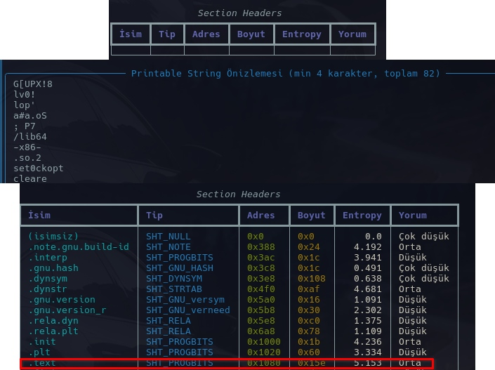
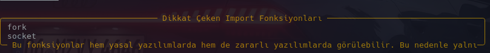
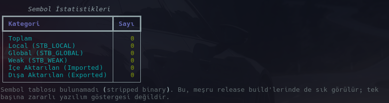
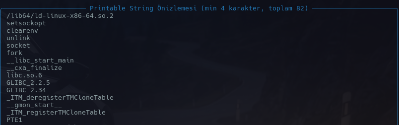

# APT Threat Report: Red Menshen & BPFDoor Anatomy

## 1. Executive Summary

Red Menshen, faaliyetleri 2018 yılına dayanan, özellikle Orta Doğu ve Asya'daki telekomünikasyon şirketlerini, lojistik altyapıları ve devlet kurumlarını hedef alan bir APT grubudur. Grubun ana hedefi, public-facing Linux ve Unix tabanlı sunuculardır.

Red Menshen'i geleneksel APT gruplarından ayıran temel unsur, hedef ağlarda kullandıkları custom backdoor olan **BPFDoor** zararlısıdır. Klasik zararlı yazılımlar sistemde port açıp dinlemeye geçerek C2 iletişimi kurarken, BPFDoor sistemde port açmaz. Bunun yerine Linux çekirdeğindeki paket filtreleme mimarisini (cBPF) kullanarak doğrudan bir raw socket (`AF_PACKET`) açar.

Zararlı bu sayede, ağ trafiğini host tabanlı güvenlik duvarlarına (`iptables`, `nftables`) ve network stack'e ulaşmadan doğrudan L2 seviyesinde okur. BPFDoor, `netstat` veya `ss` gibi standart network monitor araçlarında bir listener olarak görünmez. Sisteme sızdıktan sonra pasif durumda bekler ve yalnızca saldırgan tarafından gönderilen spesifik bir "Magic Packet" (ICMP, TCP veya UDP üzerinden iletilen özel bir hex payload) ile tetiklendiğinde C2 iletişimini başlatır. Bu yapı, grubun ağlarda uzun süre tespit edilmeden kalıcılık sağlamasına imkan tanımıştır.

## 2. Campaign Timeline

Red Menshen'in operasyonları ve BPFDoor zararlısı, EDR ve SIEM tespit mekanizmalarını atlatacak şekilde evrilmiştir:

* **2018 - 2019 (Geliştirme ve İlk İzler):** BPFDoor'un erken versiyonlarının, zafiyetli public-facing Linux router ve sunuculara bırakılması. Bu dönemde zararlı, raw socket üzerinden ağ trafiğini sniff etme işlevlerini test etmektedir.
* **2020 - 2021 (Kalıcılık ve Gizlenme):** Telekomünikasyon firmalarına yönelik aktif sızmalar. Zararlının, kendi process ismini sistemdeki yasal daemon'lar (`dbus-daemon`, `systemd-journal`, `kswapd0`) gibi göstererek masquerading uyguladığı ve kalıcılık için `init.d` script'lerini manipüle ettiği dönem.
* **Mayıs 2022 (Tespit ve Analiz):** PwC ve Elastic Security Labs tarafından yayınlanan teknik analiz raporlarıyla BPFDoor'un cBPF mimarisini nasıl kullandığı deşifre edildi ve IOC'ler paylaşıldı.
* **2022 Sonrası (Taktiksel Değişim):** Güvenlik firmalarının YARA kuralları yayınlamasının ardından grubun BPFDoor kaynak kodunda modifikasyonlara gitmesi. Statik tespitten kaçınmak amacıyla şifreleme algoritmalarının ve BPF filter yapılarının güncellenmesi.

### 2.1. Öne Çıkan Kampanyalar

Red Menshen'in tespit edilen operasyonları incelendiğinde grubun finansal kazanç yerine doğrudan siber casusluk  ve ağ istihbaratı toplamaya odaklandığı görülmektedir.

#### Kampanya 1: Asya ve Orta Doğu Telekomünikasyon Sızmaları (2018–2021)

- **Hedef Profil:** Orta Doğu ve Asya'daki büyük telekomünikasyon firmaları.
- **Saldırı Vektörü:** Zafiyet barındıran public-facing Linux ve Solaris sunucuların (DNS sunucuları, e-posta geçitleri, load balancer'lar) exploit edilmesi.
- **Operasyonel Detaylar:** Red Menshen, bu kampanyada BPFDoor'u ağ trafiğinin en yoğun olduğu endpointlere yerleştirmiştir. Magic packet yapısının noisy network içinde kaybolması hedeflenmiştir. Grup sunucularda root yetkisi elde ettikten sonra sistemin standart işleyişini bozmamaya özen göstermiş backdoor'u yalnızca periyodik istihbarat toplamak ve lateral movement noktası olarak kullanmak üzere pasif modda bekletmiştir.

#### Kampanya 2: Kamu ve Lojistik Altyapı Operasyonları (2021–2022)

- **Hedef Profil:** Devlet kurumları ve stratejik lojistik altyapıları.
- **Saldırı Vektörü:** Kompromize edilmiş edge cihazlar üzerinden iç ağdaki kritik Linux sunuculara yanal hareket.
- **Operasyonel Detaylar:** Bu kampanyada grubun anti-forensics tekniklerine ağırlık verdiği görülmüştür. BPFDoor, `kswapd0` ve `udevd` gibi yasal daemon isimleriyle masquerading uygulayarak yüksek uptime oranına sahip sunucularda aylarca tespit edilmeden çalışmıştır. Grup tespit edilme riskini minimize etmek adına diskte dosya bırakmaktan kaçınmış  ve C2 iletişimini port açmak yerine tamamen ICMP/UDP magic packet'ler üzerinden gerçekleştirmiştir.

## 3. MITRE ATT&CK TTP Haritalandırması

Bu bölümde Red Menshen grubunun ve BPFDoor zararlısının hedef sistemlerde kullandığı spesifik teknikler MITRE ATT&CK baz alınarak incelenmiştir.

### 3.1. Process Name Spoofing

```yaml
id: T1036.004
tactic: Defense Evasion
technique: Masquerading (Task Name/Process Spoofing)
platform: Linux
```

#### Tekniğin Açıklaması

BPFDoor, sisteme yerleşip çalışmaya başladıktan sonra kendini gizlemek için process ismini manipüle eder. Zararlı, sistem yöneticilerinin ve EDR çözümlerinin dikkatini çekmemek adına `argv[0]` argümanının üzerine yazarak kendini `/sbin/udevd`, `dbus-daemon`, `systemd-journal` veya `kswapd0` gibi yasal Linux daemon'ları olarak gösterir.

#### İşleyiş ve PoC

Zararlının C kodunda `fork()` çağrısı yapıldıktan sonra child process kendi komut satırı argümanını değiştirir.

```c
//BPFDoor process spoofing örneği (C Pseudocode)
strncpy(argv[0], "/sbin/udevd -d", strlen(argv[0]));
```

Bu işlem sonucunda `ps aux` veya `top` gibi komutlar çalıştırıldığında zararlının gerçek adı yerine spoof edilmiş daemon adı listelenir.

#### Tespit Yöntemleri

Process isminin değişmesi, `/proc` dizinindeki tutarsızlıklar üzerinden tespit edilebilir. Spoof edilmiş bir process'in `cmdline` değeri değişirken, asıl binary'yi işaret eden `exe` sembolik linki orijinal zararlının yolunu göstermeye devam eder.

* **Auditd / Telemetry:** `/proc/[pid]/exe` linkinin `/usr/sbin/` veya `/lib/systemd/` gibi standart sistem dizinleri dışında bir konumu (örneğin `/tmp` veya `/dev/shm`) işaret etmesi şüphelidir.
* **YARA:** Memory scan işlemi sırasında beklenmeyen bellek alanlarında BPFDoor signature'larının aranması.

#### Savunma

* EDR ile process execution loglarının (Sysmon for Linux vb.) toplanması ve process command-line değişikliklerinin alert olarak değerlendirilmesi.

### 3.2. Magic Packet & Raw Socket Dinleme

```yaml
id: T1205
tactic: Defense Evasion, Command and Control
technique: Traffic Signaling (Magic Packet)
platform: Linux
```

#### Tekniğin Açıklaması

Geleneksel backdoor'lar C2 sunucusuyla iletişim için spesifik bir TCP/UDP portu açıp dinlemeye (bind/listen) geçer. BPFDoor ise `AF_PACKET` socket kullanarak doğrudan L2 seviyesinde ağ paketlerini yakalar. Zararlıya gömülü olan cBPF filtresi, yalnızca içinde saldırgana ait belirli bir "Magic Packet" (hex pattern) barındıran paketleri kabul eder. Diğer tüm trafik drop edilmeden işletim sisteminin normal network stack'ine iletilir.

#### İşleyiş ve PoC

Zararlı, port açmamak için raw socket başlatır ve `SO_ATTACH_FILTER` ile filtreyi kernel'a uygular.

```c
//AF_PACKET ile raw socket açılması
int sock = socket(AF_PACKET, SOCK_RAW, htons(ETH_P_ALL));

//Kernel'a cBPF filtresinin uygulanması
setsockopt(sock, SOL_SOCKET, SO_ATTACH_FILTER, &bpf_filter_struct, sizeof(bpf_filter_struct));
```

Magic Packet sisteme ulaştığında `iptables` kuralları henüz devreye girmeden BPF filtresi paketi yakalar ve backdoor komutlarını çalıştırır.

#### Tespit Yöntemleri

* **Auditd Rule:** `AF_PACKET` socket açan (özellikle root veya yasal olmayan daemon'lar tarafından) sistem çağrıları (`socket` syscall) loglanmalıdır.
* **Network Telemetry:** Hedef sunucuya ping (ICMP) atıldığında veya rastgele TCP paketleri gönderildiğinde, payload içerisinde gereksiz/rastgele boyutlu hex veriler görülmesi (Magic Packet).
* **BPF Tool:** Sistemde aktif olan ve yasal olmayan BPF filtreleri `bpftool prog show` komutu ile listelenip incelenebilir.

#### Savunma

* Zararlının raw socket açabilmesi için `CAP_NET_RAW` yetkisine ihtiyacı vardır. Yasal olmayan process'ler için bu capability kısıtlanmalıdır.

### 3.3. Boot Script Manipulation

```yaml
id: T1037.004
tactic: Persistence
technique: Boot or Logon Initialization Scripts: rc.common
platform: Linux
```

#### Tekniğin Açıklaması

BPFDoor, reboot işleminden sonra RAM üzerinde tekrar aktif olabilmek için sistemin başlangıç script'lerini hedefler. Yeni ve şüpheli bir servis dosyası oluşturmak yerine, sistemde zaten var olan ve yasal kabul edilen `init.d` script'lerinin (örneğin `iptables`, `rsyslog` veya `sshd`) içine kendi çalıştırma komutunu yerleştirir.

#### İşleyiş ve PoC

Saldırgan, zararlıyı genellikle geçici dosya sistemlerine (`/dev/shm` veya `/tmp`) indirir ve yasal bir bash script'inin içine execution komutunu ekler.

```bash
#Yasal bir init.d script'ine zararlı payload'un eklenmesi
echo "/dev/shm/kswapd0 &" >> /etc/rc.d/init.d/rsyslog
```

Sistem boot sürecinde `rsyslog` servisini ayağa kaldırırken BPFDoor binary'si de arka planda çalıştırılarak raw socket açma işlemine başlar.

#### Tespit Yöntemleri

Sistem başlangıç dosyalarındaki yetkisiz değişiklikler File Integrity Monitoring araçları ile tespit edilebilir.

* **Auditd:** `/etc/init.d/`, `/etc/rc.d/` ve `/etc/systemd/system/` dizinlerindeki dosyalara yönelik `write` ve `append` syscall aktivitelerinin loglanması.
* **Stat Analizi:** Kritik başlangıç dosyalarının `mtime` değerlerindeki anormallikler.

#### Savunma

* Kritik dizinlerdeki (`/etc/init.d/`) konfigürasyon dosyalarına strict dosya izinleri (read-only) atanması ve FIM (örneğin Wazuh, Tripwire) üzerinden değişikliklerin anlık monitör edilmesi.

### 3.4. Binary Deletion & Environment Wiping

```yaml
id: T1070.004
tactic: Defense Evasion
technique: Indicator Removal on Host: File Deletion
platform: Linux
```

#### Tekniğin Açıklaması

Zararlı, RAM üzerinde çalışmaya başladıktan hemen sonra statik analizi zorlaştırmak ve diskte iz bırakmamak için kendi binary dosyasını dosya sisteminden siler. Process çalışmaya devam eder ancak dosyaya disk üzerinden erişilemez. Ayrıca, execution esnasında oluşan değişken izlerini temizlemek için environment değişkenlerini sıfırlar.

#### İşleyiş ve PoC

BPFDoor, C kodunda `fork()` sonrası kendi dosya yolunu `unlink()` syscall'u ile siler ve `environ` pointer'ını temizler.

```c
//Binary'nin diskten silinmesi ve environment temizliği
unlink(argv[0]);
clearenv();
```

Bu işlem sonucunda zararlı bellekte aktif kalır ancak Incident Response ekipleri zararlının hash değerini almak veya statik analiz yapmak için diske baktıklarında dosyayı bulamaz.

#### Tespit Yöntemleri

Bir process'in çalışmaya devam edip kaynak dosyasının diskten silinmiş olması Linux memory analitiğinde en güçlü göstergelerden biridir.

* **Procfs Analizi:** Çalışan process'lerin listelendiği `/proc` dizininde, binary linkinin yanında `(deleted)` ibaresinin bulunması.

```bash
ls -l /proc/*/exe | grep "deleted"
```

* **Auditd Rule:** Özellikle `/tmp`, `/var/tmp` veya `/dev/shm` dizinlerinden çalıştırılan dosyaların kendi üzerinde `unlink` veya `unlinkat` syscall çağırması.

#### Savunma

* `noexec` Mount Flag: `/tmp`, `/var/tmp` ve `/dev/shm` gibi temporary file system dizinlerinin `noexec`  parametresi ile mount edilmesi, zararlının bu dizinlerden execute edilmesini doğrudan engeller.

## 4. Zararlı Yazılım Anatomisi: BPFDoor ve ZayoELF Analizi

BPFDoor zararlısının yapısı, hem statik analiz araçları hem de dinamik davranış izleme yöntemleri ile incelendiğinde geleneksel backdoor'lardan ayrılan spesifik özellikler gösterir. Bu bölümde, statik analiz için **ZayoELF Analyzer** aracı kullanılarak zararlının profili ve runtime anatomisi detaylandırılmıştır.

### 4.1. Statik Analiz Profili

BPFDoor binary'si ZayoELF aracı ile analiz edildiğinde, zararlının doğasını ortaya koyan temel bulgular şunlardır:

* **Packer / Anti-Analysis Tespiti:** ZayoELF analizinde dosyanın Section Headers tablosunun tamamen silindiği tespit edilmiştir. Bu durum, string önizlemesinde açıkça görülen `UPX!` ibareleriyle birleştiğinde, zararlının statik analizi atlatmak amacıyla paketlendiğinin net bir göstergesidir. Manuel unpack işlemi sonrasında dosyanın orijinal yapısı kurtarılmış asıl zararlı kodu barındıran `.text` bölümünün entropisi olağan seviye olan 5.153 olarak ölçülmüş ve gizlenen `.dynsym` ile `.plt` tabloları açığa çıkarılmıştır.

<div align="center">
  
  <br>
  <em>Şekil 1: Entropy analizi</em>
</div>

* **Sembol Tablosu ve Şüpheli Import'lar:** Zararlının analizden kaçmak için genellikle *stripped* olarak derlendiği görülür. Sembollerin bırakıldığı varyantlarda ZayoELF'in "Dikkat Çeken Import Fonksiyonları" modülü; `socket`, `setsockopt`, `fork`, `unlink` ve `clearenv` çağrılarını doğrudan tespit eder. Bu kombinasyon, raw socket kullanan ve kendini diskten silmeyi hedefleyen bir zararlının tipik imzasıdır.

<div align="center">
  
  <br>
  <em>Şekil 2: Sembollerin bırakılmadığı varyant</em>
</div>

<div align="center">
  
  <br>
  <em>Şekil 3: Sembollerin bırakıldığı varyant</em>
</div>

* **String Önizlemesi:** ZayoELF string sonuçlarına göre, zararlı içerisinde cleartext halinde bir C2 IP adresi veya domain tespit edilmemiştir. Elde edilen dizgiler ağırlıklı olarak zararlının orijinal kaynak dosyasına (`bpfdoor.c`) ve kritik sistem çağrılarına (`socket`, `fork`, `setsockopt`, `clearenv`, `unlink`) aittir. Özellikle `clearenv`  ve `unlink` fonksiyonlarının varlığı, zararlının sistemde masquerading mekanizmalarına sahip olduğuna dair güçlü statik analiz bulgularıdır.

<div align="center">
  
  <br>
  <em>Şekil 4: String analizi</em>
</div>

### 4.2. Dinamik Analiz ve cBPF Entegrasyonu

Runtime'da BPFDoor'un temel işlevi ağ trafiğini L2 seviyesinde okumak ve süzmektir. Bu işlem için modern eBPF yerine geriye dönük uyumluluk ve daha geniş Linux çekirdek desteği sağlayan **classic BPF (cBPF)** mekanizmasını kullanır.

1. **Raw Socket Başlatma:** Zararlı, `socket(AF_PACKET, SOCK_RAW, htons(ETH_P_ALL))` sistem çağrısı ile cihazdaki tüm ağ arayüzlerini dinlemeye başlar.
2. **Filtre Uygulama:** C kodunda derlenmiş olan cBPF bytecode'u (bir `struct sock_fprog` yapısı), `setsockopt` ve `SO_ATTACH_FILTER` parametreleri kullanılarak açılan raw socket'e ilişkilendirilir.
3. **Network Stack Bypass:** Uygulanan bu cBPF filtresi, işletim sisteminin `iptables` veya `firewalld` kurallarından önce devreye girer. Yalnızca *magic packet* desenini içeren paketler zararlı tarafından alınır. Filtreyle eşleşmeyen trafik, drop edilmeden işletim sisteminin normal ağ yığını tarafından işlenmeye devam eder.

## 5. Campaign Execution Flow & Architecture

Red Menshen grubunun BPFDoor operasyonlarındaki tipik saldırı zinciri ve zararlının ağ mimarisindeki yeri aşağıda detaylandırılmıştır.

### 5.1. BPFDoor Network Architecture

Aşağıdaki diyagram, sisteme gelen bir ağ paketinin, işletim sisteminin güvenlik duvarı kurallarına takılmadan BPFDoor tarafından nasıl yakalandığını göstermektedir.

```text
[Attacker (C2)]
      │
      ▼ (Magic Packet - TCP/UDP/ICMP)
[Public-Facing Linux Server]
      │
      ▼
[Network Interface Card (NIC)]
      │
      ▼ (L2 Data Link Layer)
+---------------------------------------------------+
| Linux Kernel                                      |
|                                                   |
|  [cBPF Filter] <─────────────── (AF_PACKET) ────┐ |
|        │ (Match? YES)                           │ |
|        ▼                                        │ |
|  [BPFDoor Process] ─────────────────────────────┘ |
|  (Executes bind shell or reverse shell)           |
|                                                   |
|        │ (Match? NO)                              |
|        ▼                                          |
|  [Standard Network Stack (TCP/IP)]                |
|        │                                          |
|        ▼                                          |
|  [Host Firewall (iptables / nftables)]            |
+---------------------------------------------------+
```

### 5.2. Operational Lifecycle

1. **Initial Access:** Genellikle public-facing sunuculardaki (Web, VPN, Router) zafiyetlerin sömürülmesi veya brute-force yöntemleriyle sunucuya ilk erişimin sağlanması.
2. **Execution & Masquerading:** BPFDoor payload'u `/dev/shm` veya `/tmp` gibi dizinlere indirilir. Çalıştırıldığı anda `fork()` yapar ve child process ismini (`argv[0]`) `/sbin/udevd` veya `kswapd0` olarak değiştirerek kendini yasal bir daemon gibi gizler.
3. **Persistence:** Yasal bir `/etc/init.d/` script'ine (örneğin `rsyslog` veya `iptables` başlatma dosyasına) zararlının execution komutu inject edilir.
4. **Defense Evasion (Cleanup):** Zararlı, disk üzerindeki kendi executable dosyasını `unlink()` çağrısı ile siler ve `clearenv()` ile ortam değişkenlerini temizleyerek Forensic ekipleri için statik izleri yok eder.
5. **Signaling:** Zararlı, raw socket üzerinden pasif dinlemeye geçer. Saldırgan, dışarıdan Magic Packet gönderene kadar sessiz kalır.
6. **Action on Objectives:** Magic Packet tespit edildiğinde, BPFDoor ya bir bind shell açar ya da saldırganın IP'sine reverse shell bağlar. Bağlantı kapandığında tekrar pasif dinleme moduna döner.

## 6. Indicators of Compromise (IoC)

BPFDoor'un stealth yapısı nedeniyle statik hash değerleri hızla değişebilmektedir. Bu nedenle tespit mekanizmaları davranışsal ve host-tabanlı anormalliklere odaklanmalıdır.

### Host-Based Indicators

| Kategori | Gösterge (Indicator) | Açıklama |
| --- | --- | --- |
| **Process Name (Spoofed)** | `kswapd0`, `/sbin/udevd -d`, `dbus-daemon`, `systemd-journal` | Zararlının kendini sistemde gizlemek için büründüğü sahte process adları. |
| **Suspicious Paths** | `/dev/shm/`, `/tmp/`, `/var/tmp/`, `/run/` | Zararlının geçici olarak diske inip çalıştırıldığı ve sonrasında silindiği dizinler. |
| **Syscall Anomalies** | `socket(AF_PACKET)`, `setsockopt(SO_ATTACH_FILTER)`, `unlink()`, `clearenv()` | Raw socket açma, cBPF filtresi takma ve ortamı temizleme zinciri. |
| **Process State** | `(deleted)` | Çalışan bir process'in diskteki kaynak dosyasının silinmiş olması. |
| **Capabilities** | `CAP_NET_RAW` | EDR ve Linux process loglarında, yasal olmayan bir process'in paket okuma yetkisi kullanması. |

## 7. Threat Hunting Notes

Signature-based tespit sistemlerini atlatan BPFDoor varyantlarını yakalamak için aşağıdaki Threat Hunting hipotezleri kullanılmalıdır:

### Hunt 1: Raw Socket (AF_PACKET) Açan Process'lerin Tespiti

* **Hipotez:** BPFDoor, TCP/UDP portu açmak yerine doğrudan L2 trafiğini dinlemek için AF_PACKET kullanır.
* **Veri Kaynağı:** Linux Auditd, Sysmon for Linux.
* **Mantık:** Ağ analizi araçları (tcpdump, Wireshark vb.) haricinde `socket` çağrısında `AF_PACKET` (veya `SOCK_RAW`) parametresini kullanan process'leri yakala.
* **Örnek Auditd Kuralı:**

```bash
-a always,exit -F arch=b64 -S socket -F a0=17 -k raw_socket_creation
#a0=17 (AF_PACKET)
```

### Hunt 2: Memory'de Çalışan "Deleted" Binary Analizi

* **Hipotez:** Zararlı, çalıştıktan hemen sonra `unlink()` ile kendini diskten siler.
* **Veri Kaynağı:** Procfs (`/proc`).
* **Mantık:** Bellekte çalışmaya devam eden ancak diskteki orijinal executable dosyası silinmiş process'leri listele.
* **Bash Tespiti:**

```bash
ls -al /proc/*/exe | grep "deleted"
```

*(Not: Normal sistem güncellemeleri sırasında da bazı servisler bu duruma düşebilir, dönen sonuçlar `/dev/shm` veya `/tmp` dizinlerini işaret ediyorsa kritik olarak işaretlenebilir.)*

### Hunt 3: Process Execution Spoofing (argv vs exe Uyumsuzluğu)

* **Hipotez:** BPFDoor `argv[0]` değerinin üzerine yazarak kendini `udevd` gibi gösterir, ancak process'in asıl kaynak konumu (`exe` linki) farklıdır.
* **Veri Kaynağı:** EDR telemetry veya Procfs.
* **Mantık:** `/proc/[PID]/cmdline` değeri ile `/proc/[PID]/exe` konumunun birbiriyle anlamsal olarak uyuşmadığı durumları tespit et.
* **Bash Tespiti:**

```bash
for pid in $(ls /proc | grep -E '^[0-9]+$'); do 
  exe_path=$(readlink -f /proc/$pid/exe 2>/dev/null); 
  cmdline=$(tr '\0' ' ' < /proc/$pid/cmdline 2>/dev/null); 
  #Analiz için bu ikiliyi karşılaştır
done
```

## 8. MITRE ATT&CK Matrix Summary

| Tactic | Technique | ID |
| --- | --- | --- |
| **Initial Access** | Exploit Public-Facing Application | T1190 |
| **Execution** | Command and Scripting Interpreter | T1059 |
| **Persistence** | Boot or Logon Initialization Scripts: rc.common | T1037.004 |
| **Defense Evasion** | Masquerading: Task Name/Process Spoofing | T1036.004 |
| **Defense Evasion** | Indicator Removal on Host: File Deletion | T1070.004 |
| **Command and Control** | Traffic Signaling (Magic Packet) | T1205 |

## 9. Conclusion

BPFDoor, klasik ağ tabanlı tespit mekanizmalarının sınırlılıklarını gösteren önemli bir örnektir. Port dinlemeyen mimarisi, classic BPF filtrelerini kullanması ve davranış odaklı gizlenme teknikleri nedeniyle yalnızca imza tabanlı yaklaşımlar yeterli değildir. Bu nedenle davranış analizi, sistem çağrılarının izlenmesi ve tehdit avcılığı faaliyetleri modern Linux ortamlarında kritik önem taşımaktadır.

## 10. References

* **PwC Threat Intelligence:** "Red Menshen: A telecom-focused threat actor" (May 2022)
* **Elastic Security Labs:** "A Peek Behind the BPFDoor" - In-depth eBPF/cBPF malware analysis (May 2022)
* **Sandfly Security:** "BPFDoor - Stealthy Linux Malware Bypasses Firewalls" (Technical deep-dive on AF_PACKET and execution flow)
* **Kevin Beaumont (DoublePulsar):** "BPFDoor - A stealthy Linux backdoor" (Threat intelligence & IOCs)
* **MITRE ATT&CK Framework:** Enterprise Linux Matrix (Tactic and Technique definitions)
  